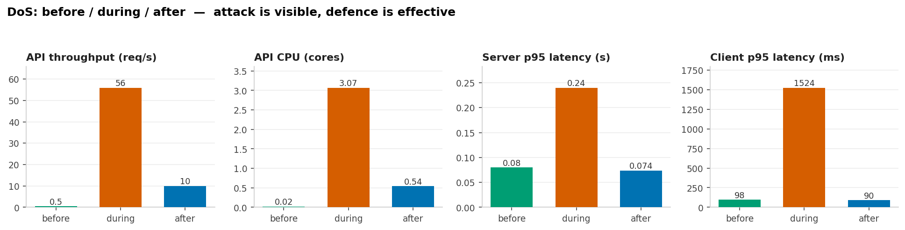
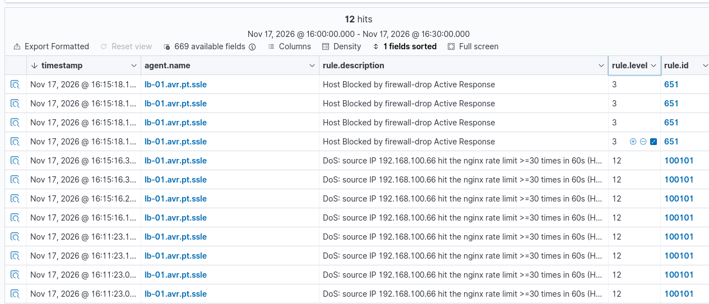
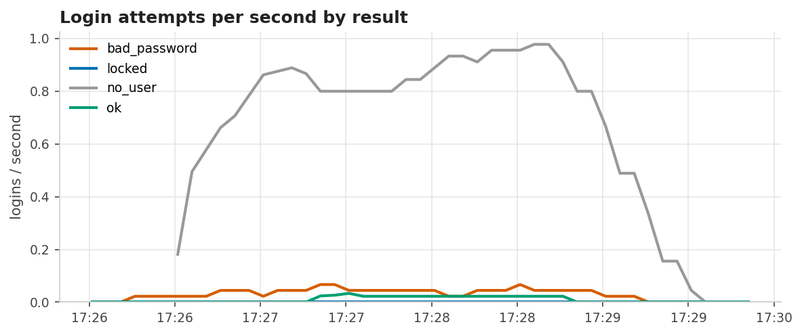
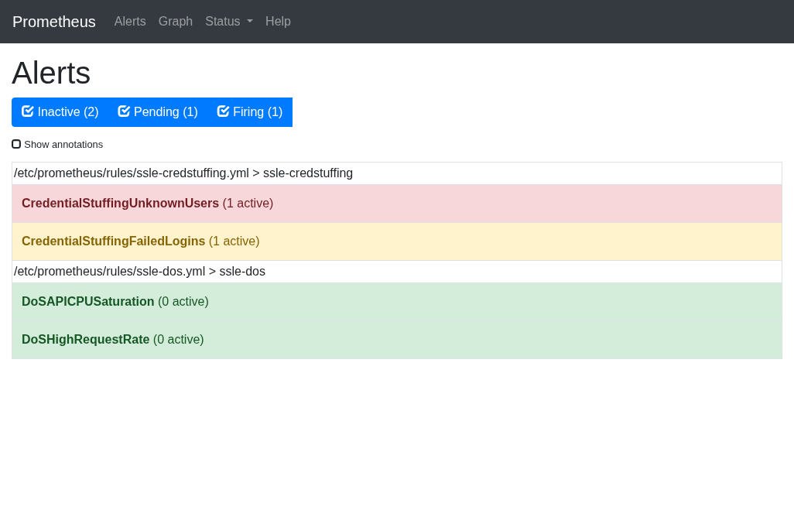
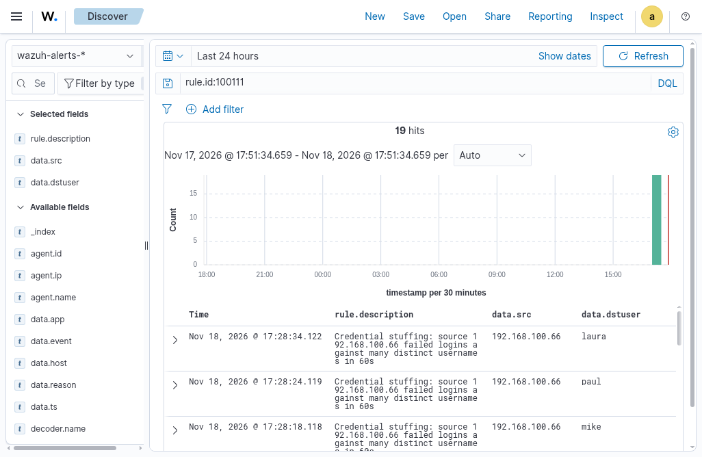
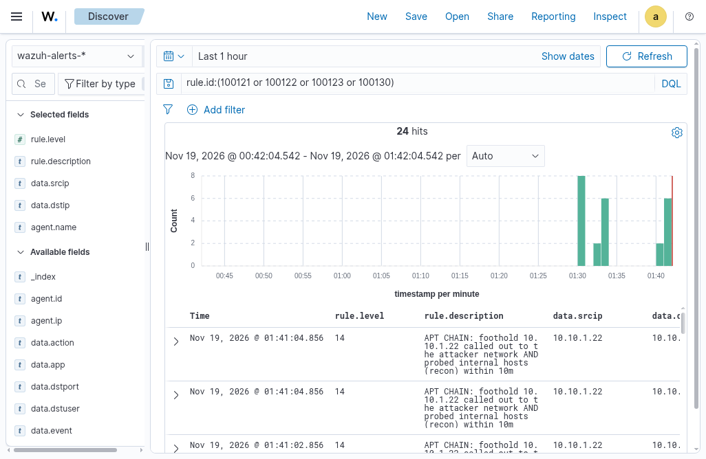
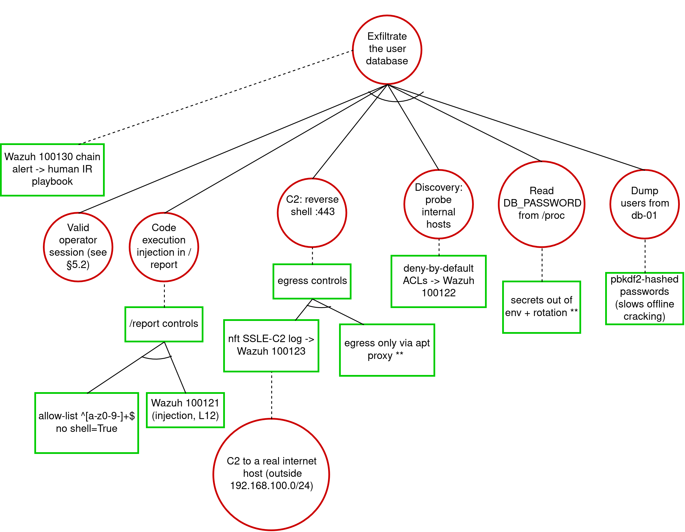

## 1. Introduction

Large-scale services are built to grow. They add instances, sites and users over time,
and each of those also gives an attacker more room to work with. This project
designs a service architecture that is meant to scale, but the main question is not only
whether it scales. It is whether, when the system is attacked, the attack can actually
be seen, traced to its source and responded to, and whether responding automatically is
always the right choice.

The system under test is a small **sensor-portal service**. A public nginx load balancer
sits in front of two replicated Flask APIs and a PostgreSQL database, and next to them
there is a monitoring and security plane made of **Prometheus** for metrics and **Wazuh**
as the SIEM. Every component runs in its own Incus instance and follows a DNS-style
naming scheme that scales. Everything is created by a single idempotent script, so the
whole environment can be rebuilt from the repository with a short and fixed sequence of
runs. This includes a second site that shows how the system grows horizontally.
Section 3 describes the architecture, and Section 4 explains the risk-management
reasoning behind it, covering the attack surfaces, the attack and defence trees and how
monitoring works at a larger scale.

This system is then attacked with the three threats from the course syllabus. Each one is
detected with Prometheus and Wazuh and has its own response, described in Section 5:

1. a **denial-of-service** flood at the application layer,
2. **credential stuffing**, including a distributed botnet version, and
3. an **advanced persistent threat (APT)**, a multi-stage intrusion that starts from the
   foothold left behind by credential stuffing.

These are not three separate case studies. They are **chained** on purpose.
The slow password hash that makes the DoS flood expensive is the same cost that
credential stuffing has to pay. The one weak password found by credential stuffing
becomes the foothold for the APT. And the database that all these defences protect is
exactly what the APT ends up reaching. Read in order, they tell a single story about the
same system under growing pressure.

That story leads to the main argument of this report:

> **The quieter, more distributed and more internal a threat becomes, the less an
> automatic block makes sense. At some point it turns from the right response into the
> wrong one, and detection, correlation and careful human judgement have to take its
> place.**

The DoS flood is loud, comes from outside and blocking it causes little collateral
damage, so an automatic firewall block per IP is both safe and effective. Credential
stuffing spread over a botnet gets around every control that works per source, so the
response changes to locking the targeted account and raising an alert based on the
**aggregate** behaviour, without blocking anyone automatically. In the APT the
"attacker" is one of the system's own production hosts, so blocking it automatically
would take down the service itself. Here the response is detection, correlation and a playbook
that a human follows. The same reflex that protects the system against the first threat
would hurt it under the third.

Behind all of this there is a split of responsibilities between the two monitoring tools
that comes up again and again. **Prometheus shows whether the aggregate looks wrong,
for example whether the service is saturated or the whole site is being stuffed. Wazuh
shows who did it and acts on it.** Each threat shifts the weight between these two questions.
Section 6 evaluates the solution as a whole, including the places where it is imperfect
on purpose, because understanding why a defence fails is also a useful result. Section 7
closes with the conclusions.

## 2. Relevant State of the Art

Most of the techniques used in this project are not new. They come from well-established
work in security and network management, summarised here.

**Risk modelling with attack and defence trees.** Attack trees were introduced by
Schneier [1]. They model an attacker's goal as a root node that is refined into
sub-goals and concrete steps, combined with AND/OR gates, which gives a systematic way
to list the ways a system can be attacked. Kordy et al. [2] extended them into
*attack-defence trees*, where countermeasures appear in the same structure as the
attacks, so that each mitigation is reasoned about next to the threat it answers.
Section 4 uses this formalism directly. A system-level attack-defence tree (Fig. 2) has
the three threats as OR-refinements of a single goal, and each threat is then expanded
in its own subtree in Section 5 (Figs. 4, 9, 11), with the defences shown as
countermeasure nodes.

**Large-scale monitoring and fault management.** The classic framework for managing
large networks is the ITU-T TMN model, with its FCAPS functional areas of fault,
configuration, accounting, performance and security management [3]. This project
follows its fault-management workflow: detect → isolate → correlate → mitigate →
post-mortem. For the performance and health view the project uses Prometheus [4], a
pull-based time-series system in which each target exposes metrics and a central server
scrapes them. Prometheus also supports federation for aggregating several sites, and
that is the mechanism behind the bandwidth-aware, per-site collection described in Sections 3.6 and 6.3.

**SIEM and security event correlation.** FCAPS fault management is defined for
operational faults and not for security events. Handling security events is the job
of a Security Information and Event Management (SIEM) system. Bhatt et al. [5] describe
how SIEMs work in practice: they normalise logs coming from many sources and
correlate them into higher-level incidents. They also point out that correlation, not
collection, is the hard and valuable part, which is exactly what the APT results in Section 5.3
show. The SIEM used here is Wazuh [6], an open-source platform with agents, a decoder
and rule engine, correlation and active response, and it is applied throughout
Section 5.

**The threats.** OWASP lists credential stuffing as an automated threat (OAT-008) [7].
It consists of replaying credentials leaked from other services against a login
endpoint, and it works because people reuse passwords, something Thomas et al. [8]
measured across billions of exposed credentials. Advanced persistent threats are
multi-stage intrusions. Alshamrani et al. [9] survey the APT lifecycle and explain why
it is hard to detect the attack as a whole instead of one stage at a time, which is
the motivation for the correlation-based detection used here. The MITRE ATT&CK
knowledge base [10] provides the common vocabulary of adversary tactics, and the kill
chain in Section 5.3 follows it (initial access → execution → C2 → discovery → credential
access → exfiltration). Denial of service does not need an external framework, so it is
treated as an application-layer resource-exhaustion problem (Section 5.1). Across all three
threats the organising principle is *defence-in-depth*, meaning independent, layered
controls where one layer covers the blind spots of another. Section 6.2 evaluates how
well this holds.

## 3. Service Architecture Used

The system is a small **sensor-portal service**. Operators log in through a public
load balancer and read sensor data from a replicated API that sits on top of a
database. Every component runs as its own **Incus** instance, and the whole environment
is produced by a single idempotent build script (`scripts/build.sh`). It takes one run
for the management and outside zones (`core`), one run per site (`site avr`,
`site lis`) and two host-level steps that need root (`host-exporter`, `host-agent`).
With these five commands the entire lab, attack tooling included, is rebuilt from the
repository, and any of them can be run again safely. Figure 1 shows the four network
zones, the application call graph and the monitoring and SIEM plane.

{height=19cm}

*Figure 1. Service architecture. **Solid** edges are application traffic (client →
`lb-01` → `api-01/02` and `analytics-01` → `db-01`, with analytics being read-only).
**Thick red** edges are attacker traffic from the outside world, and **green dotted**
edges are the Prometheus scrape and federation flows. Wazuh is not drawn as edges.
Every instance and `h01` runs an agent that reports to `siem-01` (:1514/1515), as noted
on its box. The dashed `analytics-01` box is design-only. The physical host `h01` runs every container and is observed, not
trusted, by its own exporter and Wazuh agent.*

### 3.1 Components, the call graph, and the single exposed surface

The service tier lives in the site network `ssle-avr` (10.10.1.0/24). It contains an
**nginx** load balancer `lb-01`, two replicated Flask APIs `api-01` and `api-02` that
serve the login and sensor endpoints, and a PostgreSQL database `db-01`. An
`analytics-01` instance, which would serve the read-only `/stats` and `/average`
endpoints, is specified but kept as design only. A separate management network
`ssle-mgmt` (10.10.0.0/24) holds the monitoring and security plane, made of `prom-01`
(Prometheus) and `siem-01` (Wazuh), so that observation traffic stays apart from
service traffic. The outside world is modelled as a third zone, `inet`, with a
legitimate `client-01` and the adversary hosts `attacker-01..03`.

The call graph is kept **small and explicit** on purpose: `client → lb-01 → api → db`,
plus the management flows. This is more than documentation, because it is the baseline
that the APT detection compares against (Section 5.3). Any connection that is not an
edge in this graph is suspicious by definition. The most important structural property
is that **`lb-01:80` is the only surface reachable from `inet`.** Every other instance
is internal, so an attacker cannot reach the APIs or the database directly and has to
go through the application. This is what forces the APT to exploit the service itself
instead of simply connecting to the database, and Section 4 develops it further as the
attack surface.

### 3.2 A scalable naming scheme

The project explicitly requires a way of identifying elements that scales, and the
design uses a **DNS-style hierarchical name**:

```
<service>-<instance>.<site>.<region>.<org>     e.g.  api-02.avr.pt.ssle
```

Incus instance names cannot contain dots because they must be valid hostnames. For that
reason the short name (`api-02`) is the instance name, and the fully qualified name is
built from the network's `dns.domain`. The project guidelines list the key aspects a naming scheme has to address, and each
one is answered below:

- **Where is the element, logically and physically?** The name encodes the logical
  location (`site.region.org`). The physical host is intentionally **not** part of the
  name. It is metadata, observed by the per-host exporter (Section 3.6) and never
  declared. Keeping the two apart means a container can move to another physical host
  without breaking every log, alert and dashboard that refers to it. The logical name
  stays stable and works as the key, while the physical location is a label that can
  change underneath it.
- **Who is responsible when an alert fires?** Ownership is **hybrid**. Each zone has a
  default owner (e.g. `avr.pt.ssle → ops-avr`), and an instance overrides it with
  `user.owner` only when it differs (e.g. `db-01` belongs to `team-data`). The lookup
  goes from the instance up through the zone hierarchy until it reaches the org.
  Owners are always teams and never individual people, so they survive staff changes.
- **How quickly can an incident be located?** Since the name carries the site and the
  region and resolves to an owner, a single alert says both where the event happened
  and who has to act. This covers the "quickly locate event source" criterion and also
  allows monitoring by location, which is the bandwidth-optimisation bonus discussed
  in Section 6.

*Limitation.* The metadata (host and owner) is self-declared, so someone with root on
the VM can change it and send responders to the wrong place. This can be mitigated by
alerting on metadata changes and by comparing the live metadata with the build script
in git, but that only detects the change and does not prevent it.

### 3.3 Addressing and DNS delegation

Each subnet reserves `.1` for the gateway, `.2–.99` for **fixed** addresses (DHCP
reservations written by the build script) and `.100–.254` for dynamic leases, so a
lease can never collide with a fixed address. Fixed addresses are needed because the
firewall rules are written with **IPs**. Incus bridge ACLs cannot match "instances
holding ACL *x*", only addresses (verified: `Unsupported nftables subject`).

Name resolution is **delegated only where it is needed**. Each Incus network knows only
its own zone, and a single `raw.dnsmasq` line per delegated zone connects them
(`server=/avr.pt.ssle/10.10.1.1`). Delegation goes from `mgmt` to the sites, so that
Prometheus can resolve scrape targets by name, and from the sites to `mgmt`, so that
Wazuh agents can find `siem-01.ssle`. There is **no** delegation between sites. Each
site is self-contained, and less resolution means less attack surface. Because dnsmasq
uses the longest matching rule, a site keeps answering its own names even when the
central resolver is down, and this was confirmed in testing.

*Limitation.* The central resolver `10.10.0.1` is a single point of failure for every
cross-zone lookup. On top of that, a failed lookup takes about 20 s to time out, so a
DNS outage does not fail fast. It turns into a **slowdown**, which is a
denial-of-service side effect, and an agent that re-enrols during the outage cannot
find the SIEM at exactly the moment something may be wrong. Two possible mitigations
are to give the agents the manager's IP instead of its name, or to run a second
resolver for the `ssle` zone.

### 3.4 Network isolation: deny-by-default and anti-spoofing

The firewall is **deny-by-default**. The build script generates one ACL per role and
site from the call graph and attaches it to every instance with that role. Unmatched
ingress is **dropped**, so a scan gets no reply and learns nothing. Unmatched egress is
**rejected**, so the system's own services fail fast instead of hanging. Every interface also has
`security.ipv4_filtering` and `security.mac_filtering` enabled, which stops a
compromised container from sending traffic with another instance's address. Without
this, the IP-based rules could be bypassed simply by changing an IP. Tests from
`client-01` confirmed the intended behaviour. The login path works end-to-end, while
direct access to the APIs or the database, lateral hops between backends and spoofing
attempts are all blocked.

`lb-01` is **dual-homed**, with one interface on `inet` and one on `ssle-avr`. nginx
overwrites the client's `X-Forwarded-For` header with the address it actually saw, and
the API trusts exactly one proxy hop, so a forged header is thrown away. Testing
revealed a real weakness here. The VM routes between its bridges **without NAT**, so
before the forwarding rule existed an outsider could reach an API directly and also
forge their source IP in the logs. The fix is a rule that drops all forwarding from
`inet` into the internal subnets. With it in place, **only `src` can be trusted**, and
only because of nginx and the firewall working together.

*Limitation.* Installing packages with `apt` needs outbound access to ports 80 and 443
on the internet, so that egress is allowed to any address. This is also a path for a
reverse shell or for exfiltration, and it comes back as a detection problem in
Section 5.3. Bridge-ACL drops are also recorded only in the VM's kernel log, so using
them as a signal means shipping that log to Wazuh, which was done for the APT. Finally,
nothing is encrypted in transit. `lb-01` serves plain HTTP on port 80 and proxies to the
APIs over HTTP, so operators' passwords and session cookies cross the outside zone in
clear text. TLS termination at `lb-01` is the production fix (Section 6.3). It was left
out because it protects against an eavesdropper, and none of the three threats is one.

### 3.5 Trustworthy logging

The APIs write their logs as **JSON, one object per line** (`json.dumps`). An earlier
`key=value` format turned out to be vulnerable to **log injection**, because a username
containing a newline could forge a whole fake log line. An attacker could, for example,
write many `login_failed` lines carrying the IP of a legitimate client. Wazuh's active
response would then block an innocent user, which is a denial of service without any
flood at all. JSON encoding escapes newlines and quotes inside values, and values are
also capped at 128 characters.

*Limitation.* JSON prevents user input from changing the **structure** of an event, but
not its **content**. Fields such as `user` are still controlled by the attacker, so
detection rules must never trust them and the dashboard must display them safely. Only
`src` can be trusted, again because of nginx and the firewall.

### 3.6 Monitoring and SIEM components

Monitoring follows the Prometheus **pull** model. Application metrics are exposed on a
dedicated port (`:9102`) that nginx never proxies and that the firewall opens only to
`prom-01`. This keeps the login-failure counters invisible from `inet` and from a
compromised backend. Resource metrics such as CPU, memory and network come from a
**single host exporter per physical machine** on `:9101` and not from inside each
container. They are observed and not declared, so root inside a compromised container
cannot fake its own numbers. `siem-01` runs Wazuh all-in-one, with an agent on every
instance registered under its fully qualified name, since short names repeat across
sites. One more agent runs on the physical host `h01` and ships the firewall and IDS
logs that the APT detection relies on. To keep Figure 1 readable, these agent links are noted on `siem-01` instead of drawn
as edges.

The design also plans for **horizontal growth**. A second site, `lis`, has its own
database and a local Prometheus that the central one **federates**. This is
intentionally a different collection pattern from `avr`, which is scraped directly. The
asymmetry exists so that the bandwidth cost of each pattern can be measured instead of
just claimed, and Section 6.3 reports those numbers from the built `lis` site. The
reasoning behind the monitoring strategy (what each tool watches and why), the attack
surface and attack-defence tree analysis and the scalability evaluation are developed
in Sections 4 and 6.

## 4. Risk Management and Mitigation

Section 3 described the architecture as it was built. This section looks at it as a
risk surface, considering what an attacker can reach, how the three threats fit into a
single attack-defence model and how the system is monitored at scale, so that an attack
is seen, located and correlated instead of just logged.

### 4.1 Attack surfaces

An attack surface is the set of points where an adversary can interact with the system.
The first principle of the design is to keep the **external** surface as small as
possible, and from `inet` the only reachable point is `lb-01:80`. There is no direct
route to an API, to the database or to the monitoring plane. This is enforced by the
deny-by-default firewall and the no-NAT forwarding rule (Section 3.4), and testing
confirmed that every path except `client → lb-01:80` is dropped. A port scan from
outside therefore sees a single HTTP port and learns nothing else.

The surfaces that matter are the ones that remain, because they are what the three
threats actually exploit:

- **The login endpoint itself** (`POST /login`). It has to be exposed, and it is
  expensive because of the pbkdf2 hash. This makes it both a DoS amplifier and an oracle
  for credential stuffing.
- **An intentionally vulnerable application endpoint** (`/report`, with command
  injection, behind authentication and `SSLE_VULNERABLE=1`). It stands in for the
  post-authentication bug an APT needs, since the network offers no other way in.
- **The broad outbound 80/443 egress rule.** The service needs it to reach the
  internet, but once a backend is compromised it also becomes a path for a reverse shell
  and for exfiltration.
- **Internal surfaces of lower value**, namely the unauthenticated `/metrics` ports and
  the single DNS resolver, each protected only by a firewall rule (Sections 3.3
  and 3.6).

Reducing the external surface to one port does not remove the risk. It **moves** it to
the application layer and to what an attacker can do after gaining a foothold. That is
why the three threats go after the cost of the login, a reused credential and an
application bug, and not after the network.

### 4.2 Attack-defence tree

The model is an **attack-defence tree** as defined by Kordy et al. [2], drawn with
their graphical conventions (red circles for attacks, green rectangles for defences,
dotted countermeasure edges and an arc for AND). Two markers were added for this
project, `**` for defences that were not implemented and the "ENABLES" link between
branches. The attacker's goal sits at the root and is refined downwards into the ways of achieving
it, with countermeasures attached to the attack nodes they mitigate. Figure 2 is the top
of the tree, with the goal and the three threats. Each threat is then refined in its own
subtree, next to its detection and response in Section 5 (Figs. 4, 9 and 11).

{width=75%}

*Figure 2. System attack-defence tree, top level (notation in the legend below). The
three threats are **alternative** ways to compromise the portal (OR). Exfiltrating the
user database is an AND, since it needs a valid operator session **and** the post-login
steps refined in Fig. 11. The purple "ENABLES" link is the chain between branches, where
the account takeover of threat 2 provides the operator session that threat 3 needs.*

All four attack-defence figures (Figs. 2, 4, 9 and 11) use the same notation:

| Symbol | Meaning |
|---|---|
| red circle | attack (the goal or an attacker step) |
| green rectangle | defence (countermeasure) |
| `**` after a defence | proposed defence, **not implemented** in this project |
| solid lines from a parent | OR refinement: any one child achieves the parent |
| solid lines joined by an arc | AND refinement: every child is needed (in no particular order) |
| black dotted line | countermeasure: a defence against an attack, or an attack that defeats a defence |
| purple dashed line "ENABLES" | one branch's outcome is a step in another branch |

Two features of the tree matter for the rest of the report. Exfiltration is an AND of
six steps (Fig. 11), so every step is a chance to detect the APT, which is why its
detection relies on correlation (Section 5.3). The counter-attacks and the `**` nodes
show where prevention stops working: a botnet defeats every per-IP control, and some
steps have no preventive control at all, which Section 6 evaluates.

### 4.3 Large-scale monitoring

Monitoring follows the FCAPS fault-management workflow (detect → diagnose/isolate →
correlate → mitigate → post-mortem). FCAPS is defined for operational faults and not
for security events, so monitoring runs on two planes in parallel, Prometheus for
operational metrics and Wazuh for security events.

The monitoring was also designed to keep up as the system grows. Resource metrics come
from one exporter per physical machine (Section 3.6), so adding containers adds no
exporters, and a compromised container cannot fake its own numbers. Combined with the
naming scheme (Section 3.2), every metric and alert points to a site and an owner. A
second site has its own Prometheus that the central one federates, which reduces the
traffic between sites (Section 6.3). Finally, Wazuh correlation rules combine weak
individual events into a single alert, which is how the APT is detected (Section 5.3).

*Limitations.* The whole system runs on one physical VM, so the scale is emulated and
the bandwidth saving is measured between bridges and not across a real WAN. Under a
volumetric flood the SIEM itself becomes a target, and agents drop events when the
attack is loudest (Section 5.1).

## 5. Approach to the Three Threats

Each threat is described, explained in terms of why it matters for this system and
how it is exploited, and then followed by its monitoring and metrics, the response
adopted and a post-mortem of the proof of concept. Following the argument from Section 1, the response that is
correct for the first threat becomes less and less appropriate for the next two.

### 5.1 Denial of Service (application-layer flood)

**Description.** The attack is a flood of `POST /login` requests against the only
exposed surface, `lb-01:80`. It is detected by **volume and saturation**, which is what
separates it from credential stuffing (Section 5.2). It counts as an application-layer
DoS, and not a raw packet flood, because of the cost of the login endpoint. Every failed
login runs an intentionally slow pbkdf2 hash. Measured at idle, one `/login` request
costs about 66.7 ms of server work, while a `/health` check without hashing costs about
1.4 ms. That is an **amplification of about 47×**, so a request that is cheap to send
is expensive to serve.

**Relevance.** Because of this amplification the flood is dangerous without needing much
bandwidth. A modest request rate turns directly into CPU exhaustion on the APIs, and
the login service degrades for every legitimate user. It is also the most basic test of
whether the monitoring stack can see an attack at all.

**Exploitation.** A concurrency ramp with `ab` finds the knee of the curve. Throughput
rises to a ceiling and then stays flat, while latency grows linearly with concurrency
(Little's Law). At c=5 the service reaches about 50 req/s, and by c=80 legitimate users
wait about 1.6 s per request. The measured ceiling of **about 50 req/s is a finding in
itself**, since it is well below the roughly 90 req/s predicted from "6 workers × 15
req/s". The prediction assumed six CPU cores, but the VM has four, shared with nginx,
the database, Prometheus, Wazuh and the OS, which leaves about three free for hashing.
Running two API instances did **not** double the capacity, because both share the same
physical cores. This confirms with a measurement the "both sites share one VM" caveat
that comes back in the scalability discussion (Section 6).

**Monitoring and metrics.** In Prometheus the flood shows up as a throughput spike,
rising p95 latency, a surge of `bad_password` failures and API CPU climbing towards
saturation (Fig. 3). One measurement changed the alerting strategy. The **server-side**
p95 (238 ms) was far lower than the **client-side** p95 (1524 ms), because the server
histogram only times the work done inside a worker and cannot see the roughly 1.3 s a
request spends waiting in gunicorn's backlog. Latency measured at the server is
therefore a weak DoS signal, while **request rate and CPU saturation are more
reliable**, and these are what the Prometheus alert rules (`DoSHighRequestRate`,
`DoSAPICPUSaturation`) use. On the SIEM side, nginx `429` lines are decoded as web
access logs, and custom rules escalate `100100` (one 429) to `100101` (≥30 from one
source IP in 60 s, level 12). Layering the defences has a further consequence. Once
nginx rate limiting is on, the 429s never reach the application, so the flood becomes
**invisible to the application metrics in Prometheus**, and detection moves to the
edge, from the nginx logs to Wazuh.



*Figure 3. DoS before, during and after. The c=50 flood drives throughput and API CPU
up, and login latency with them. nginx `limit_req` then caps the flood back to the
per-IP limit. Rendered from Prometheus's range API.*

{width=55%}

*Figure 4. DoS attack-defence subtree (notation as in the legend in Section 4.2). The
flood is answered by two per-IP controls that act together (AND). A botnet defeats both,
leaving only the aggregate Prometheus alert. Lockout abuse has only a proposed defence
(`**`).*

Figure 4 places the controls of this section on the attack they answer. *Deny service*
has two alternatives. The **flood** is countered by the **per-IP controls**, nginx
`limit_req` and the Wazuh `100101` → `firewall-drop` block, described next. The second
alternative, **locking victims out on purpose**, needs no flood at all. It is a side
effect of the lockout from Section 5.2 and is discussed in the post-mortem.

**Action-response.** The response has two layers. For **prevention**, nginx `limit_req`
(10 r/s, burst 20 → HTTP 429) cut a single-source flood from about 56 to about 10 req/s
reaching the APIs. API CPU dropped from about 3.07 to 0.54 cores and p95 from 0.24 to
0.074 s, because the cheap 429 shields the expensive hash path. For **active response**,
a Wazuh `firewall-drop` tied to rule `100101` adds an `iptables` DROP for the offending
IP on `lb-01` for 600 s. This was verified live. The attacker (`.66`) was blocked
within a few seconds (confirmed by built-in rule 651, Fig. 5), the legitimate client was
not affected and the block expired on its own. In this case the automatic per-IP block
is the **right** response, because the attacker is external and loud, and blocking it
causes little collateral damage.

| Phase | req/s | server p95 | API CPU (cores) | client view |
|---|---|---|---|---|
| before | ~0.5 | ~0.08 s | ~0.02 | 15 req/s @ c=1 |
| during (c=50) | ~56 | 0.24 s | ~3.07 | mean 923 ms, p95 1524 ms, 0 failed |
| after (`limit_req`) | ~10 (capped) | 0.074 s | ~0.54 | ~10 req/s reach API; rest 429 |



*Figure 5. The DoS active response in the Wazuh dashboard. In the 16:15 burst, rule
`100101` (level 12, "source 192.168.100.66 hit the nginx rate limit ≥30 times in 60 s")
fires on `lb-01`, and two seconds later built-in rule 651 records the `firewall-drop`
block of that address.*

**Post-mortem.** The service **degraded but did not crash**. There were no failed
requests, but latency went up 13×, and a heavier flood would pass the 30 s gunicorn
timeout and cause real errors. Two limitations turned out to be important. The first is
that the **monitoring pipeline has its own DoS ceiling**. During a burst of 12 000 req/s
of 429s, the Wazuh agent on `lb-01` filled its buffer and logged "Events may be lost".
A volumetric flood therefore drops SIEM events exactly when the attack is loudest, and
here the aggregate Prometheus signal and the nginx edge are more reliable than alerting
on individual events.

The second limitation leads into the next section. The per-IP rate limit and the per-IP
block both **assume a single source**. If the same request budget is spread across a
botnet, both are defeated. Each bot stays under 10 r/s and under the `100101` threshold,
while the APIs still receive the full sum. This is the *distribute flood over a botnet*
node in Fig. 4. The attack is still visible to the Prometheus request rate and CPU
saturation alerts, because they measure the total for the site and not any single
source. However, they only **detect** it. There is no safe per-IP block left to
trigger, so the response falls back to adding capacity and to a human decision. The
control that works here is the one that Section 5.2 breaks.

The second branch of the tree, **locking victims out on purpose**, is a denial of
service without a flood. Anyone who knows a username can send five wrong passwords and
lock that operator out for 15 minutes, over and over, turning the lockout from
Section 5.2 against its own users. Its countermeasure, a **soft lockout or backoff**, is
proposed (`**`) but not implemented. Instead of a hard lock, each further failure would
add an increasing delay for that account, answered immediately with a `429` and a
`Retry-After` header instead of holding a gunicorn worker. A server-side `sleep` would
turn the defence into a new DoS amplifier. The trade-off is that the real user is still
slowed down, just not locked out, and a botnet can keep the delay at its maximum. The
slow pbkdf2 hash that is used here as an amplifier comes back in Section 5.2, where the
per-account lockout is designed to **avoid** paying it.

### 5.2 Credential Stuffing (and the botnet variant)

**Description.** Credential stuffing replays a leaked `username:password` dump against
`POST /login`. Unlike the DoS flood, it is detected by what the logins mean and not by
their volume. It shows up as failed logins across many distinct usernames from one
source, and most of those usernames do not exist in this system. The application labels
every attempt as `ok | bad_password | no_user`, and `no_user` is the clearest signal.
Legitimate users never type a username that does not exist, so its baseline is **0**,
while a leaked dump is full of them.

| | DoS (Section 5.1) | Credential stuffing (Section 5.2) |
|---|---|---|
| shape | huge volume on one username | one try each across many usernames |
| signature | request rate / CPU saturation | `no_user` across distinct users |
| pace | as fast as possible | low-and-slow, under the per-IP limit |
| edge sees it? | yes (429s, CPU) | **no** (measured: zero 429s) |
| response | per-IP block | account lockout + aggregate alert |

**Relevance.** Because people reuse passwords, stuffing is cheap and effective and
needs no exploit or malware. The attacker is betting that a credential leaked somewhere
else was reused here. One seeded operator, `bob`, uses `password123`, and the run
**takes over his account**, while `alice` (with a strong passphrase) and `carol` are not
affected. This single takeover is the quiet foothold that Section 5.3 builds on.

**Exploitation.** The horizontal spray uses 43 pairs: 40 non-existent users, `alice` and
`carol` with wrong leaked passwords, and `bob:password123`. Paced at 60 per minute, it
stays under the nginx limit of 10 r/s and produced **0 × 429** over 240 s, which
confirms that the edge defence from the first threat cannot see it. It still took over
`bob`. The takeover appears only in the log (`login_ok, user=bob, src=.66`) and never in
the metrics, which carry no IP by design. A vertical brute-force against a single
account is the case the lockout is built to stop.

The **botnet variant** is the key experiment. The same dump is split across three
sources (`attacker-01..03`). Each one sprays its own slice of the dump, paced so that
in any 60 s window a single source touches fewer than the 8 distinct usernames the
Wazuh rule needs:

| signal | single source | distributed (3 bots) |
|---|---|---|
| Wazuh `100111` (≥8 distinct users/60 s, one src) | fired 25× | **0** (never fires) |
| Prometheus `no_user` aggregate alert | fired | **fired** (18.7/min) |
| takeover of `bob` | yes (.66) | yes (.67) |

Distribution **blinds every per-source control**: the Wazuh correlation per `src`, the
nginx per-IP limit and, by extension, any `firewall-drop` block. The **aggregate**
`no_user` rate, however, does not change and still triggers the Prometheus alert. This
is the main argument for an aggregate response instead of a per-IP one. Figure 6 shows
the signature of the spray in the aggregate metrics, and Figure 7 shows the Prometheus
alerts during the botnet run.



*Figure 6. The signature of the spray. `no_user` jumps from a baseline of 0 to about
58/min while every other login result stays flat. It is an almost perfect signal and is
invisible to the DoS panels (CPU at about 0.014 cores, roughly 200× below the flood).*

{width=70%}

*Figure 7. Prometheus alerts during the botnet run. The aggregate
`CredentialStuffingUnknownUsers` alert is firing and the backup
`CredentialStuffingFailedLogins` is pending, while both DoS alerts stay inactive, since
the stuffing is invisible to the DoS thresholds. In the same run Wazuh's per-source rule
`100111` fired 0 times (table above).*

**Monitoring and metrics.** There are two independent layers, and both were verified to
fire. **Prometheus** gives the aggregate view with two tiers. The primary rule is on
`no_user` (> 3/min, against a baseline of 0, so a large margin), and a backup rule on
total failures (> 10/min) catches a targeted run that only uses valid usernames, which
the primary rule would miss. **Wazuh** gives the per-source view. Rule `100111` fires on
≥ 8 failed logins from the same `src` across distinct `dstuser` values in 60 s, and the
`different_field dstuser` option is exactly what separates stuffing from a brute-force
against a single user. The correlation runs on the **manager** and is keyed on `src`,
so it still works when nginx spreads the logins across `api-01` and `api-02` (91 and 92
events in one run). Load balancing does not affect detection. Figure 8 shows the rule's
alerts in the Wazuh dashboard.

{width=80%}

*Figure 8. Wazuh rule `100111` during the single-source spray. Every alert has the same
`data.src` (192.168.100.66) and a different `data.dstuser`, which is the
`different_field dstuser` correlation at work.*

{width=85%}

*Figure 9. Credential-stuffing attack-defence subtree (notation as in the legend in
Section 4.2). Stuffing needs a dump, a reused password and the replay (AND). The botnet
defeats the per-source Wazuh rule and is caught only by the aggregate alert. MFA is
proposed (`**`).*

Figure 9 shows why stuffing and brute-force need different controls. **Credential
stuffing** is an AND of three conditions: the attacker has a leaked dump, a victim
reused that password here, and the dump is replayed at `/login`. Breaking any one of
them stops the attack. The first cannot be controlled by this system, because the
breach happened elsewhere. The replay is countered by Wazuh `100111`, but spreading it
over a botnet defeats that rule (25 → 0, as measured above), and the botnet is in turn
caught by the aggregate Prometheus alert on `no_user` > 3/min. This chain of counters
ends in detection and not in prevention. The only node that would actually **stop** a
takeover with a reused password is **MFA**, which is proposed (`**`) but not
implemented. The lab has no second factor, and for the application a replay of `bob`'s
correct password is just a normal login. **Brute-force against one account** is the
opposite case. It is countered by the **per-account controls**, meaning the lockout
(5 failures, 15 min) together with the backup alert on failed logins > 10/min. No
counter-attack defeats them, because the limit is per account and adding more bots does
not give more attempts.

**Action-response.** The main control is a **per-account lockout** (5 consecutive
failures lock the account for 15 min), built around three design choices. First, the
lock state is a foreign key to the `users` table, so a spray of random usernames can
never make it grow, which protects memory and is enforced by the database. Second, the
lock is checked **before** the pbkdf2 hash. A locked account therefore rejects even a
correct password, which defeats a successful stuffing hit, and it stops costing CPU,
which connects back to Section 5.1. Third, the client always receives the same generic
401, and the details are only visible on the server side. There is **intentionally no
automatic block**, because the only safe per-IP action is exactly the one the botnet
defeats. The table below shows what each control stops and what it does not:

| attack shape | lockout | aggregate alert | what actually stops it |
|---|---|---|---|
| horizontal spray | no | **yes (detects)** | detection + human response; MFA |
| vertical brute-force | **yes** | partial | lockout |
| reused-password takeover (bob) | no | no | strong password / MFA |

**Post-mortem.** `no_user` was an almost perfect signal (0 → 58.7/min), detection kept
working with load balancing, and the lockout clearly stops the vertical brute-force. It
rejected `alice`'s correct password while the account was locked, which was the
decisive test. The limitations are also useful to understand. The spray has **no safe
automatic stop**. Unlike with the DoS, the lockout does not change the curve of the
spray, because each username is tried only once, so detection and MFA (proposed, not
implemented) matter more than any block. A **timing side channel** also remains.
`no_user` and `locked` return before the hash, while a real wrong password pays its
cost, so the response time allows username enumeration even though the 401 bodies are
identical. The fix would be a constant-time dummy hash. Finally, the lockout is itself
a **DoS vector**, since an attacker who knows a username can lock it on purpose. This is
the *lock victims out on purpose* branch of Fig. 4, and its proposed fix, a soft lockout
or backoff, is discussed in Section 5.1. This threat connects back to Section 5.1,
because the hash is both a DoS cost and a cost the lockout avoids, and forward to
Section 5.3, because a stolen valid credential is a quiet foothold and not a flood.

### 5.3 Advanced Persistent Threat (the correlation threat)

**Description.** An APT is a multi-stage intrusion and not a single noisy event. Since
only `lb-01` is exposed, the chain has to go through the application. A **reused
credential** (`bob`, from Section 5.2) gives the attacker a session, and the
intentionally vulnerable `/report` endpoint turns that session into **code execution**
on an API container. A **reverse shell** then calls home, the foothold **probes the
internal network**, reads the **database password from the process environment** and
**exfiltrates** the `users` table. This is the correlation threat because no single
step is conclusive on its own. A strange `/report` argument could come from a scanner,
one blocked probe could be a typo and one outbound connection could be a package
download. The signature is the chain, meaning the same host doing several of these
things in sequence and close together in time.

**Relevance.** An APT is the scenario the whole monitoring stack exists for, and it
connects the first two threats. The quiet foothold is the takeover from Section 5.2, and
the prize is the database that the DoS and stuffing defences were protecting all along.
It also tests the parts of the design that only matter during a real intrusion: the
deny-by-default firewall, which blocks and logs lateral probes, the call graph, which
defines what "a connection not in the graph" means, and the ability of the SIEM to
**correlate** events instead of just matching them.

**Exploitation.** The entry weakness is explicit and contained. `/report` passes a
user-supplied `sensor` value into a shell command (`shell=True`), behind authentication
and `SSLE_VULNERABLE=1`, and stands in for the post-authentication bug an APT needs. The
table lists the kill chain and the signal left by each stage:

| # | Stage | Signal |
|---|---|---|
| 1 | initial access: `login` as `bob` (reused cred) | app log `login_ok` |
| 2 | execution + C2: injected detached reverse shell via `/report` | injection in app log; **C2 egress** api→attacker:443 |
| 3 | discovery: probe the management network (`:22`) | **blocked lateral recon** (firewall drop) |
| 4 | credential access: read `DB_PASSWORD` from `/proc/self/environ` | (host already compromised) |
| 5 | exfiltration: connect to `db-01`, dump `users` | DB connection (looks like the app, so ambiguous) |

The payload detaches with `setsid … &`, so gunicorn's `subprocess.run(timeout=5)`
returns while the shell keeps running. That detached process and its outbound socket
are exactly what makes it an anomaly. nginx spreads `/report` requests in round robin,
so the foothold lands on either `api-01` or `api-02`, and since the detection is keyed
on the foothold IP, both cases are covered. The chain was verified end to end
(transcript in `images/apt/apt_chain_transcript.txt`): session as `bob` → reverse shell
from the API container → blocked recon → leaked `DB_PASSWORD` → `users` hashes dumped.

**Monitoring and detection.** All signals arrive at the manager, and three of them are
used as legs of the chain. Command **injection** (`100121`, level 12) fires when
`sensor` contains a character outside the **allow-list** `^[a-z0-9-]+$`. Using an
allow-list instead of a blocklist means no forgotten metacharacter can get past it.
**C2 egress** (`100123`) comes from a host nft rule that logs every new TCP connection
from a site subnet to the external actor network (`SSLE-C2`). It is a reverse-shell and
exfiltration signal with no false positives, and it also covers the "new outbound
connection" gap noted in the architecture. **Blocked recon** (`100122`) comes from the
kernel log of each firewall drop. The DB login is only used to back up the other
signals, because it looks like normal application traffic. The chain is also
**fileless**, so FIM has nothing to detect. A variant that drops files would be caught
by FIM, and this capability is documented but not forced into the chain.

The correlation rule `100130` (**level 14, the highest in the project**) fires when the
same foothold both connects out to the attacker network **and** probes internal hosts
within 10 minutes. Figure 10 shows it firing on the PoC chain. Building this rule
revealed an important property of the SIEM. Wazuh's `if_matched_sid` correlation works
**per agent** (and per rule-matching thread). A correlation across agents, with the
injection seen by the API agent and the recon seen by the host agent, **never fired**
live, while the same correlation within one agent fired immediately.

For this reason the chain is built from **two signals that the same agent, the host
agent, observes** (C2 egress and recon). It also uses `analysisd.rule_matching_threads=1`
so that correlated events are not split across threads, and `<same_source_ip/>` instead
of `<same_field>srcip</…>`, which fails silently because `srcip` is a static field. The
injection stays a standalone level-12 alert that shows how the attacker got in, because
it cannot be correlated automatically across agents. In production this would be fixed
by normalising host identity, so that application logs and network events share a key.



*Figure 10. The `100130` chain alert (level 14) in the Wazuh dashboard. A single
foothold both reached the attacker network and probed internal hosts within ten minutes.
Neither leg alone proves an intrusion, but the two together do.*



*Figure 11. APT attack-defence subtree (notation as in the legend in Section 4.2).
Exfiltration needs all six children (AND, unordered, with the order given by the kill
chain table above). The chain alert `100130` counters the root. A C2 server outside the
lab's actor network defeats the egress log, and two defences are proposed (`**`).*

Figure 11 places a defence under each necessary step. **Code execution** is countered
by the **/report controls**, the allow-list `^[a-z0-9-]+$` without `shell=True`,
together with Wazuh `100121`. In the PoC only the detection half is deployed. The
allow-list exists as the `100121` regex, while the application keeps `shell=True` on
purpose, because `/report` is the stand-in entry bug, and applying the fix is one of the
playbook steps below. The **C2 reverse shell** is countered by the **egress controls**,
the `SSLE-C2` nft log → `100123`, together with **egress only through an `apt` proxy**
(`**`). The counter-attack under them, **C2 to a real internet host**, is the other side
of the "no false positives" property mentioned above. The nft rule only logs connections
to `192.168.100.0/24`, the lab's actor zone, so it never fires on legitimate traffic
only because the lab knows where the attacker is. A real adversary on any internet
address, using port 443, passes through the broad 80/443 egress rule (Section 3.4) and
is **neither blocked nor logged**. Only the proposed proxy would close this gap, because
with it every direct outbound connection becomes an anomaly. **Discovery** is countered
by the deny-by-default ACLs, whose drops feed `100122`. **Reading `DB_PASSWORD` from
`/proc`** is countered only by **keeping secrets out of the environment and rotating
them** (`**`), and **dumping `users`** only by the pbkdf2-hashed passwords, which slow
down offline cracking. Both are discussed in the post-mortem. The root itself is
countered by the `100130` chain alert and the human playbook below.

**Action-response.** The decision is to **alert and not act automatically**. `100130`
notifies a human, who then follows a manual playbook. For the DoS the automatic block
was safe, but for an APT the same reflex is dangerous, for four reasons. First, the
"attacker" is now an **internal production host**, so isolating it automatically on a
false positive would cause an outage. Second, the confidence of each individual signal
is low by design, and only the chain is reliable. Third, an automatic block **warns**
the adversary, who then becomes quieter. Fourth, isolation **destroys volatile
evidence** such as the shell running in memory. The playbook first looks at the chain
for the foothold IP and takes a snapshot of the container before touching it. It then
contains only that container. Because there are **two APIs, the service survives**
losing one, which is a trade-off an automatic kill would not take into account. After
that it rotates the leaked `DB_PASSWORD`, fixes `/report` (using an argument list and the
same `^[a-z0-9-]+$` validation), deals with the entry point (`bob`'s reused password,
and MFA) and finally rebuilds the container from the build script with one command.

**Post-mortem.** The chain runs end to end and every stage leaves a distinct signal
that was verified. The allow-list injection rule and the `SSLE-C2` egress rule both have
almost no false positives, and `100130` fires live on the real chain. The limitations
are where most of the learning is. Wazuh's **per-agent correlation** forced the chain to
be designed around the host. The C2 signal only exists because the broad 80/443 egress
rule exists, and it only covers C2 inside the lab's actor network. If that rule were
replaced by **egress only through an `apt` proxy** (proposed, not implemented), the
reverse shell would be blocked instead of just logged, wherever the attacker is. This
would be better prevention, and the leg would simply move to the drop log. Recon between
instances of the same tier (`api→db`) is not shipped, because drops inside a bridge are
logged under a different prefix that the host agent filters out, and the DB
exfiltration leg is ambiguous by nature.

A more serious limitation concerns the chain rule itself, because **discovery is not
actually necessary**. The build script puts `DB_HOST` (`db-01.avr.pt.ssle`) in the same
process environment as `DB_PASSWORD`, and `apps/api/app.py` reads both from there. The
single `cat /proc/self/environ` that leaks the password therefore also reveals the
target, so an attacker who skips the probe loses nothing. Such an attacker never
triggers `100122`, and since `100130` requires both C2 egress **and** recon, **the chain
alert never fires**. Only the standalone `100121` (level 12) and `100123` alerts remain.
Figure 11 draws discovery as an AND child because the PoC performed it, not because the
attack requires it, so the correlation depends on the attacker's habits and not on a
necessary step. The two legs that are truly necessary, injection and C2 egress, are
exactly the pair across agents that Wazuh could not correlate. Fixing this needs the
host identity normalisation described above and not a new rule.

The last two steps have only weak defences. Against reading the credential, the
playbook rotates `DB_PASSWORD` after the fact. The preventive node, **keeping secrets
out of the environment and rotating them**, is proposed (`**`). A secret that is read
once from a protected file, or issued for a short time by a vault, removes the one-line
leak through `/proc/self/environ`, and regular rotation shortens how long a stolen value
is useful. This makes the attack more expensive but does not prevent it, since code
running as the application can still reach whatever the application can. Against the
dump, the **pbkdf2-hashed passwords** mean the attacker steals hashes and not passwords,
and has to crack them offline. That protects `alice`'s passphrase but not `bob`'s
`password123`, which is in every wordlist and falls within the first guesses. A slow
hash only protects strong passwords. Most importantly, the response is intentionally
**not** automated, because the DoS reflex would take down a production host. The real
fixes are in password policy, MFA (Section 5.2) and input validation, and not in the
SIEM. The APT is the quiet opposite of the flood, and it shows why alerting on single
events is not enough, since only correlation can see it.

## 6. Evaluation of the Solution's Approaches and Scalability

The three threats are easier to evaluate side by side than one at a time, because the
most useful results come from comparing them. This section looks at two questions:
whether the chosen responses worked, and whether the architecture scales.

### 6.1 The automated-response spectrum

The central claim of this report is that **automatic blocking is the right response to
the first threat and the wrong one for the third**. The three PoCs make it possible to
show this as a measured spectrum:

| | DoS | Credential stuffing | APT |
|---|---|---|---|
| attacker location | external | external, **distributed** | **internal** (prod host) |
| attack shape | loud, volumetric | low-and-slow, many sources | low-and-slow, correlated |
| per-signal confidence | high | medium | **low** (only the chain is high) |
| collateral of a block | low (an outside IP) | **high** (shared/NAT IPs; botnet) | **severe** (self-DoS of a prod host) |
| automated block? | **yes** (safe + effective) | **no** | **no** |
| response adopted | nginx rate-limit + Wazuh firewall-drop | per-account lockout + aggregate alert | alert + human IR playbook |

Reading the table from left to right, three things change together. The attacker moves
from outside to inside, the confidence of each signal drops and the collateral damage of
an automatic block grows. The safe response changes with them, from blocking
automatically to detecting and calling a human. Two measured results support both ends
of the table. The **botnet experiment** showed Wazuh's per-source rule `100111` going
from 25 alerts with a single source to **0** with a distributed attack, while the
aggregate alert still fired. This explains why the per-IP block that stops the DoS
cannot be the response to stuffing. At the other end, the **per-agent correlation
limit** (Section 5.3) and the four reasons why automatic isolation is dangerous explain
why even a high-value APT alert is handed to a human. Automatic response is therefore
not something to apply everywhere. It depends on how external the attacker is, how
reliable the signal is and how little damage a block would cause.

### 6.2 Defence-in-depth: each layer covers another's blind spot

No single monitoring layer catches all three threats. Each threat is invisible to some
layer and caught by another:

| Layer | DoS | Credential stuffing | APT |
|---|---|---|---|
| nginx edge (rate, 429 logs) | **catches + caps** | blind (0 × 429) | blind |
| Prometheus aggregate (rate, CPU) | catches (unmitigated) | **catches** (`no_user`) | blind (no volume spike) |
| Wazuh per-event + correlation | catches (who, block) | **catches** (distinct users) | **catches** (the chain) |
| app controls (lockout, allow-list) | shields hash path | **stops** vertical brute | would prevent injection (fix not deployed, Section 5.3) |

Once nginx rate limiting is on, the DoS becomes invisible to the application metrics in
Prometheus, because the 429s never reach the application, so the **edge** handles it.
Credential stuffing is invisible to the edge (zero 429s) and to the DoS CPU threshold
(about 0.014 against 3 cores), so the **aggregate metrics and the login results** handle
it. The APT has no volume signal at all, so **correlation** handles it. Every threat
falls into the blind spot of some layer and into the view of another. A system with
only one of these layers would completely miss at least one of the three threats.

### 6.3 Scalability

**The throughput ceiling.** The clearest scalability result is a negative one. The DoS
ramp measured a hard ceiling of **about 50 req/s, limited by four shared CPU cores**,
and adding a second API instance did not raise it. The architecture is designed to scale
horizontally, but every instance and both sites share one physical VM, so the measured
throughput is limited by that host. Scale is therefore shown in the design and the
tooling, not in raw capacity.

**What scales by design.** Adding a site takes **one line in `config/sites.conf`, its
instances, and one run of the build script** (`site <name>`). The naming scheme, the
firewall ACLs, the Wazuh agents and the Prometheus scrape targets are all generated from
that configuration, so growth needs no manual editing and no central restart. The only
extra step is for a site with its own Prometheus, where the root-only `host-exporter`
step has to be run again so that the host exporter listens on the new site's bridge.
The monitoring plane scales in the same way. There is one host exporter per physical
machine instead of one per container, so the number of observers does not grow with
the number of observed instances. The hierarchical naming allows metrics and alerts to
be filtered by location and traced to an owner, which makes it quick to locate the
source of an incident. **Federation** lets a second site summarise its metrics locally,
so they are pulled in bulk instead of being scraped one by one across the link.

Building `lis` made it possible to measure this in bytes per minute, and the result is
more nuanced than expected. Over a 120 s window, the directly scraped `avr` sent about
5.3 kB/min towards the central Prometheus in 142 packets, with a fresh scrape of each of
its two app targets every 15 s. The federated `lis` sent about 22 kB/min in only **16**
packets. Federation clearly reduces the number of round trips, replacing many per-target
requests with one bulk pull per site (about 9× fewer packets). However, with the default
selector that matches everything (`{job=~".+"}`), that single pull carries the site's
entire local dataset, 67 kB and 467 series, most of them Prometheus's own internal
metrics. As configured, federation reduces **round trips but not bytes**. The bandwidth
saving comes from the selector. A selective `match[]` with only the twelve series that a
cross-site dashboard needs comes to 1.85 kB, a **36× reduction**, and this is how a
production federation would be configured. Since everything runs on one VM, this saving
is measured between bridges and not across a real WAN, so these figures show the
pattern rather than a real-world value.

**The monitoring plane is also a scaling limit.** During the volumetric flood, the Wazuh
agent on `lb-01` filled its buffer and dropped events ("Events may be lost") exactly
when the attack was loudest, and a short run already produced tens of thousands of
events. The SIEM therefore has its own capacity ceiling and is a DoS target itself.
Beyond a certain point, alerting on individual events has to give way to aggregate
signals from Prometheus and to rules that correlate without raising alerts (level 0),
so that the dashboard stays readable.

**What a real deployment would change.** Several physical hosts would give the APIs real
CPU isolation and raise the throughput ceiling, and a real WAN would make the federation
saving meaningful. TLS termination at `lb-01`, vulnerability detection turned back on,
longer retention and an egress proxy, which would block the APT's reverse shell instead
of only logging it, are all production hardening steps that the design points to but
does not implement. The reason for leaving each one out is given in the relevant
section.

## 7. Conclusions

This project designed a service-based architecture meant to scale, monitored it with
Prometheus and Wazuh and attacked it with three threats from the syllabus: a
denial-of-service flood, credential stuffing and an advanced persistent threat. Each
threat was given its own detection and response. The threats were built as one
connected story instead of three separate case studies, and the main findings of the
report come from that choice.

**Main findings.**

- **Automatic response is not a universal default.** It is the right answer to the DoS
  flood and the wrong answer to the APT, and the three PoCs show this as a measured
  spectrum (Section 6.1). As the attacker moves from outside to inside, the confidence of
  each signal falls and the collateral damage of a block grows, so the safe response
  changes from blocking automatically to detecting and calling a human.
- **The shape of an attack, not its name, decides which control works.** The botnet
  experiment gave the clearest result. Spreading the same spray over three sources took
  Wazuh's per-source correlation from 25 alerts to **0**, while the aggregate `no_user`
  alert was not affected. Per-IP rate limits and blocks, which stop the single-source
  flood, cannot answer distributed stuffing (Section 5.2).
- **Detection comes from correlation, not from collection.** The APT has no volume
  signal and is only caught by a rule that fires when one foothold does several weak
  things in sequence (Section 5.3). Building this rule revealed a concrete limit of
  Wazuh, whose `if_matched_sid` correlation only works within one agent, and the chain
  had to be designed around the host because of it.
- **Measurements corrected design assumptions.** The DoS ceiling was about 50 req/s and
  not the 90 predicted from the number of workers, because the physical cores were the
  real limit (Section 5.1). Server-side latency was also about 6× lower than the latency
  users actually saw, because it cannot see the request queue, and this changed which
  signal the alerts use.
- **Defence-in-depth works in practice.** Each threat falls into the blind spot of one
  monitoring layer and into the view of another (Section 6.2), and no single layer caught
  all three.

**Limitations.** The main limitations of the solution are summarised below.

- **One physical host.** Every instance and both sites share one VM, so throughput is
  limited (about 50 req/s) and the federation bandwidth saving is measured between
  bridges and not across a WAN. Scale is shown in the design and the tooling, not in
  raw capacity (Section 6.3).
- **The monitoring plane has its own ceiling.** Under a volumetric flood the Wazuh agent
  drops events exactly when the attack is loudest. The SIEM is therefore a DoS target
  itself, and at scale alerting on individual events has to give way to aggregate
  signals (Sections 5.1 and 6.3).
- **Per-IP controls fail against distributed attacks, and Wazuh only correlates within
  one agent.** These two limits shaped the stuffing and APT responses (Sections 5.2
  and 5.3).
- **Remaining application-layer risks.** Response timing still allows username
  enumeration, because the unknown-user and locked paths skip the hash. The account
  lockout can be abused as a DoS. The broad 80/443 egress rule also works as an
  exfiltration path (Sections 3.4 and 5.2).
- **Single points of failure and plain text.** If the central DNS resolver fails,
  cross-zone lookups slow down instead of failing fast. Self-declared metadata can be
  tampered with. Plain HTTP carries operators' passwords and session cookies in clear
  text (Sections 3.2, 3.3 and 3.4).

**Future work.** Most of the real fixes are outside the SIEM. MFA and a password policy
would stop the takeover with a reused password, which neither detection control can
prevent. An egress proxy would turn the APT's reverse shell from a logged event into a
blocked one. Several physical hosts would give the APIs real CPU isolation. TLS and a
constant-time dummy hash are smaller hardening steps also mentioned in the report. More
broadly, this project detects attacks and responds to them. The next step is attack
tolerance, meaning how the service keeps running during an attack, and the two-API
design, which already lets the service survive losing one backend (Section 5.3), is a
natural starting point for it.

**AI usage.** Throughout this project I used Claude Opus 4.8 (Anthropic) as an
assistant, in the following ways:

- **Reviewing my design decisions.** I decided the architecture and the naming scheme,
  and asked the assistant for its opinion on those decisions and their trade-offs before
  fixing them.
- **Questioning the project.** I asked the assistant to ask me questions about the
  project, which helped me find gaps in the design and prepare for the discussion.
- **Help with code.** I used the assistant to help me write and debug parts of the code
  and scripts.
- **Commenting the scripts.** The assistant wrote the descriptive comments at the top of
  my scripts.
- **Plotting the metrics.** My screenshots of the Prometheus interface were low
  resolution and hard to read, so I asked the assistant to query the Prometheus API and
  build plots from that data to show the results more clearly. My own screenshots are
  kept in the report as well.
- **Structuring the demo.** The assistant helped me organise the demonstration into a
  structured, step-by-step guide.
- **Wording the report.** The assistant helped me improve the wording and clarity of the
  report text.

I reviewed and validated every decision, result and measurement in this report, and I
remain responsible for its content.

## References

[1] B. Schneier, "Attack Trees," *Dr. Dobb's Journal*, vol. 24, no. 12, Dec. 1999. [Online]. Available:
https://www.schneier.com/academic/archives/1999/12/attack_trees.html (accessed Nov. 2026).

[2] B. Kordy, S. Mauw, S. Radomirović, and P. Schweitzer, "Foundations of
Attack–Defense Trees," in *Formal Aspects of Security and Trust (FAST 2010)*, LNCS
6561, Springer, 2011, pp. 80–95. doi:10.1007/978-3-642-19751-2_6.

[3] ITU-T, *Recommendation M.3400: TMN Management Functions*, International
Telecommunication Union, Feb. 2000. [Online]. Available:
https://www.itu.int/rec/T-REC-M.3400-200002-I/en (accessed Nov. 2026).

[4] Prometheus Authors, "Prometheus: Monitoring system & time series database."
[Online]. Available: https://prometheus.io/docs/ (accessed Nov. 2026).

[5] S. Bhatt, P. K. Manadhata, and L. Zomlot, "The Operational Role of Security
Information and Event Management Systems," *IEEE Security & Privacy*, vol. 12, no. 5,
pp. 35–41, Sep./Oct. 2014. doi:10.1109/MSP.2014.103.

[6] Wazuh Inc., "Wazuh: The Open Source Security Platform (Documentation)." [Online].
Available: https://documentation.wazuh.com/ (accessed Nov. 2026).

[7] OWASP Foundation, "Credential Stuffing (OAT-008)," *OWASP Automated Threats to Web
Applications*. [Online]. Available:
https://owasp.org/www-project-automated-threats-to-web-applications/assets/oats/EN/OAT-008_Credential_Stuffing
(accessed Nov. 2026).

[8] K. Thomas et al., "Data Breaches, Phishing, or Malware? Understanding the Risks of
Stolen Credentials," in *Proc. ACM SIGSAC Conf. on Computer and Communications Security
(CCS '17)*, 2017, pp. 1421–1434. doi:10.1145/3133956.3134067.

[9] A. Alshamrani, S. Myneni, A. Chowdhary, and D. Huang, "A Survey on Advanced
Persistent Threats: Techniques, Solutions, Challenges, and Research Opportunities,"
*IEEE Communications Surveys & Tutorials*, vol. 21, no. 2, pp. 1851–1877, 2019.
doi:10.1109/COMST.2019.2891891.

[10] B. E. Strom et al., "MITRE ATT&CK: Design and Philosophy," The MITRE Corporation,
McLean, VA, USA, Tech. Rep. MP180360R1, 2018 (rev. Mar. 2020). [Online]. Available:
https://attack.mitre.org/docs/ATTACK_Design_and_Philosophy_March_2020.pdf

