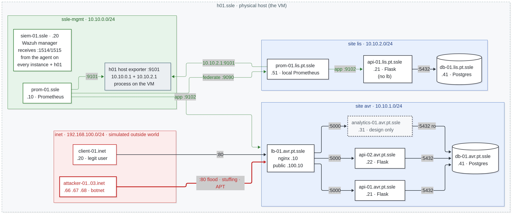
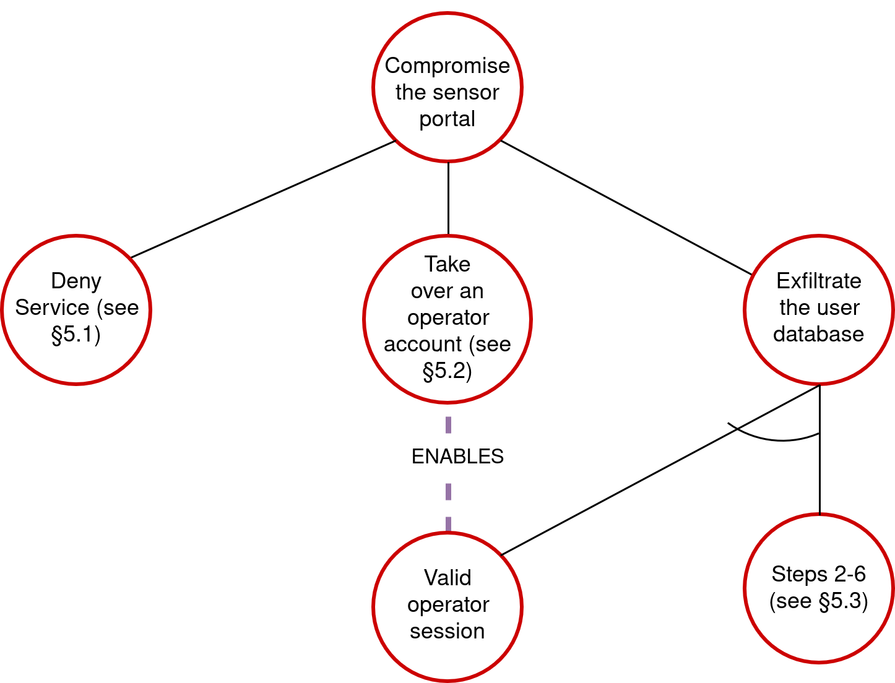
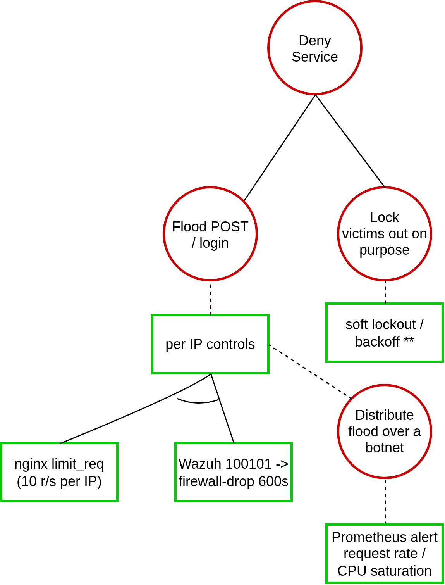
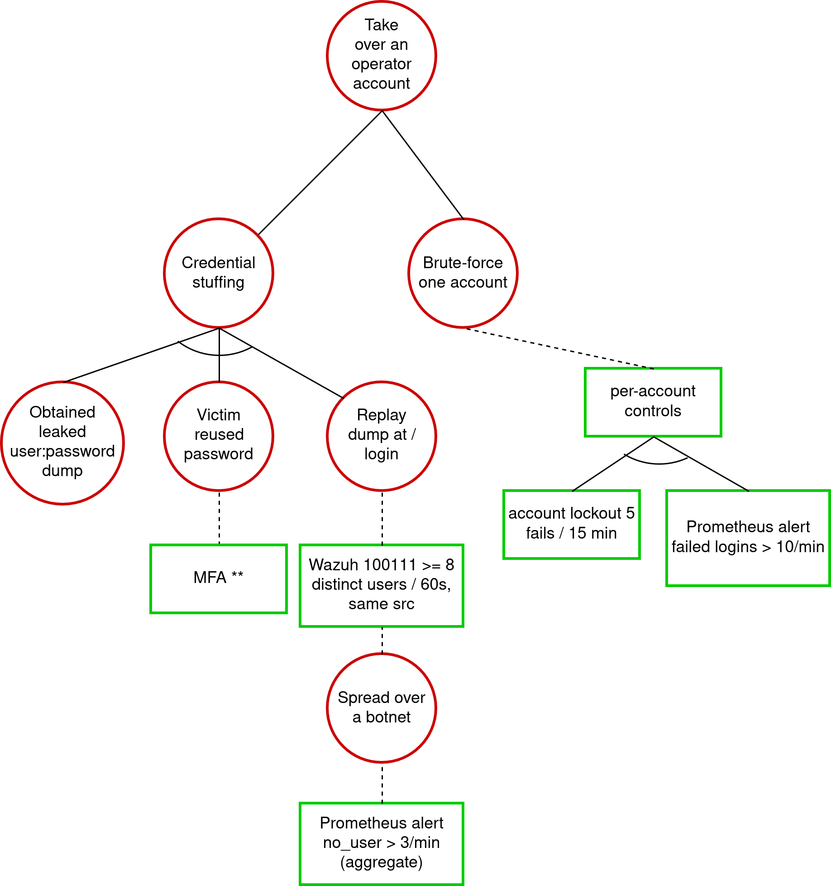

<!--
Build the PDF with:
  pandoc docs/report.md -o report.pdf --toc --number-sections \
    --resource-path=.:docs -V geometry:margin=2.5cm -V fontsize=11pt
The architecture figure is rebuilt from docs/architecture.dot with:
  dot -Tpng docs/architecture.dot -o images/architecture.png
The attack-defence trees (Figs. 2, 4, 6, 8) are images/Adtree*.drawio.png: each PNG is
its own source (draw.io embeds the diagram in it), so open it directly in draw.io
(app.diagrams.net), edit, and export again as PNG (zoom 300%, "Include a copy of my
diagram" ticked) over the same file. PNG rather than SVG because draw.io's SVG labels
are HTML (<foreignObject>), which the SVG-to-PDF step drops, leaving blank nodes.
-->

# Threat Detection, Monitoring and Prevention in a Scalable Service Architecture

**Margarida Ribeiro (119876)**

*Security in Large Scale Systems — Project 1 · Universidade de Aveiro · November 2026*

---

## 1. Introduction

Large-scale services are designed to grow — more instances, more sites, more users —
and every one of those dimensions is also a larger surface for an attacker. This
project designs a service-based architecture that is meant to scale, and then asks a
sharper question than "does it scale?": *when the system is attacked, can we see it,
locate it, and respond to it — and is an automatic response always the right move?*

The system under test is a small **sensor-portal service**: a public nginx load
balancer in front of two replicated Flask APIs, a PostgreSQL database, and a
monitoring and security plane built from **Prometheus** (metrics) and **Wazuh** (SIEM).
Every component is its own Incus instance, named by a scalable DNS-style scheme and
built from a single script, so the whole environment — and a second site to show
horizontal growth — rebuilds with one command. Section 3 describes the architecture
and Section 4 the risk-management reasoning behind it (attack surfaces, attack/defence
trees, and large-scale monitoring).

Against this system we run the three threats from the course syllabus, each detected
with Prometheus and Wazuh and each given an action-response (Section 5):

1. a **denial-of-service** application-layer flood,
2. **credential stuffing** (with its distributed, botnet variant), and
3. an **advanced persistent threat** — a multi-stage intrusion built on the foothold
   that credential stuffing leaves behind.

These are not three isolated case studies. They are deliberately **chained**: the
slow password hash that makes the DoS flood expensive is the same cost credential
stuffing pays; the one weak password that credential stuffing finds is the foothold
the APT reuses; and the database that all of these defences ultimately stand in front
of is what the APT finally reaches. Read in order, they tell one story about the same
system under increasing pressure.

That story is this report's central argument:

> **As a threat becomes quieter, more distributed, and more internal, an automated
> block moves from being the right response to being the wrong one — and detection,
> correlation, and deliberate human judgement have to take over.**

The DoS flood is loud, external, and low-collateral, so an automatic per-IP firewall
block is safe and effective. Credential stuffing, spread across a botnet, *evades*
every per-source control, so the response moves to per-account lockout plus an
**aggregate** alert, with no automatic block. The APT's "attacker" is an internal
production host, so an automatic block would be a self-inflicted outage — the response
there is detection, correlation, and a human incident-response playbook. The same
reflex that defends against the first threat would damage the system under the third.

Underlying this is a division of labour between the two monitoring tools that recurs
throughout: **Prometheus answers "is the aggregate wrong — are we saturated, is the
whole site being stuffed?", while Wazuh answers "who did it, and act on it."** Each
threat shifts the balance between those two questions, and Section 6 evaluates the
result as a whole — including where the solution is deliberately imperfect, since
understanding *why* a defence fails is itself a contribution (Section 7).

## 2. Relevant State of the Art

The design draws on four established bodies of work, each mapped here to where the
report uses it.

**Risk modelling with attack and defence trees.** Attack trees, introduced by
Schneier [1], model an attacker's goal as a root refined into sub-goals and concrete
steps combined by AND/OR gates, giving a systematic way to enumerate how a system can be
attacked. Kordy et al. [2] extend them to *attack–defence trees*, which interleave
countermeasures with attacks in the same structure so that mitigations are reasoned
about alongside the threats they answer. Section 4 uses exactly this formalism: a system
attack–defence tree (Fig. 2) with the three threats as OR-refinements of one goal, each
refined in its own subtree in Section 5 (Figs. 4, 6, 8) with defences as countermeasure
nodes.

**Large-scale monitoring and fault management.** The classic framework for managing large
networks is the ITU-T TMN model and its FCAPS functional areas — fault, configuration,
accounting, performance and security management [3] — whose fault-management workflow
(detect → isolate → correlate → mitigate → post-mortem) this project follows. For the
performance and health view it uses Prometheus [4], a pull-based time-series system in
which targets expose metrics that a central server scrapes, with federation for
multi-site aggregation — the mechanism behind the bandwidth-aware, per-site collection
of §3.6 and §6.3.

**SIEM and security event correlation.** FCAPS fault management is defined for
*operational* faults, not security events, which is the role of a Security Information
and Event Management (SIEM) system. Bhatt et al. [5] describe the operational role of
SIEMs — normalising logs from many sources and *correlating* them into higher-level
incidents — and identify correlation, not collection, as the hard and valuable part;
this is precisely the APT finding in §5.3. The project uses Wazuh [6], an open-source
SIEM providing agents, a decoder/rule engine, correlation and active response, applied
throughout §5.

**The threats.** Credential stuffing is catalogued by OWASP as an automated threat
(OAT-008) [7] — the replay against a login endpoint of credentials breached elsewhere —
and its effectiveness rests on password reuse, which Thomas et al. [8] quantify
empirically across billions of exposed credentials. Advanced persistent threats are
multi-stage intrusions; Alshamrani et al. [9] survey the APT lifecycle and the difficulty
of detecting it *as a whole* rather than at a single stage — the motivation for the
correlation-based detection used here — while the MITRE ATT&CK knowledge base [10]
provides the common vocabulary of adversary tactics the kill chain of §5.3 (initial
access → execution → C2 → discovery → credential access → exfiltration) follows. Denial
of service needs no external framework; it is treated here as an application-layer
resource-exhaustion problem (§5.1). Across all three, *defence-in-depth* — independent,
layered controls so that one layer covers another's blind spot — is the organising
principle evaluated in §6.2.

## 3. Service Architecture Used

The system is a small **sensor-portal service**: operators log in through a public
load balancer and read sensor data served by a replicated API over a database. Every
component runs as its own **Incus** instance, and the entire environment is produced
by a single idempotent build script (`scripts/build.sh`), so the lab — and, by design,
a second site — rebuilds with one command. Figure 1 shows the four network zones, the
application call graph, and the monitoring/SIEM plane.



*Figure 1. Service architecture. **Black** edges are the application call graph;
**red** the attack path from the outside world; **green dotted** the Prometheus
scrape and federation flows; **purple dashed** the Wazuh agent→manager flow (drawn
once; every instance runs an agent). The dashed `analytics-01` box is design-only; the
`lis` site is built (§6.3). The physical host `h01` runs every container and is observed, not
trusted, by its own exporter and Wazuh agent.*

### 3.1 Components, the call graph, and the single exposed surface

The service tier lives in the site network `ssle-avr` (10.10.1.0/24): an **nginx** load
balancer `lb-01`, two replicated Flask APIs `api-01`/`api-02` (login and sensor
endpoints), and a PostgreSQL database `db-01`. An `analytics-01` instance (the
read-only `/stats` and `/average` endpoints) is specified but kept design-only. A
separate management network `ssle-mgmt` (10.10.0.0/24) holds the monitoring and
security plane — `prom-01` (Prometheus) and `siem-01` (Wazuh) — so that observation
traffic is isolated from service traffic. The outside world is modelled as a third
zone, `inet`, containing a legitimate `client-01` and the adversary hosts
`attacker-01..03`.

The call graph is deliberately **small and explicit**: `client → lb-01 → api → db`,
plus the management flows. This matters beyond documentation — it is the baseline
the APT detection compares against (§5.3): *any connection that is not an edge in
this graph is, by definition, suspicious*. The most important structural property is
that **`lb-01:80` is the only surface reachable from `inet`.** Every other instance is
internal. An attacker therefore cannot address the APIs or the database directly; they
must go *through the application*, which is what forces the APT to exploit the service
itself rather than simply connecting to the database (§4 develops this as the attack
surface).

### 3.2 A scalable naming scheme

Identifying elements in a way that scales is an explicit requirement of the project,
and the design uses a **DNS-style hierarchical name**:

```
<service>-<instance>.<site>.<region>.<org>     e.g.  api-02.avr.pt.ssle
```

Because Incus instance names cannot contain dots (they must be valid hostnames), the
short name (`api-02`) is the instance and the fully-qualified name is assembled from
the network's `dns.domain`. The scheme answers the three questions the project asks of
a name:

- **Where is the element, logically and physically?** The name encodes the logical
  location (`site.region.org`). The *physical* host is deliberately **not** in the
  name — it is metadata, observed by the per-host exporter (§3.6), never declared.
  This separation is what lets a container move between physical hosts without
  invalidating every log, alert and dashboard that refers to it: the stable logical
  name is the key, and the physical location is a label that can change underneath it.
- **Who is responsible when an alert fires?** Ownership is **hybrid**: each zone has a
  default owner (e.g. `avr.pt.ssle → ops-avr`), and an instance overrides it with
  `user.owner` only where it differs (e.g. `db-01` belongs to `team-data`). Lookup
  walks from the instance up the zone hierarchy to the org. Owners are teams, never
  people, so they survive staff changes.
- **How quickly can an incident be located?** Because the name carries site and region
  and resolves to an owner, a single alert names both *where* the event is and *who*
  must act — the "quickly locate event source" criterion — and it supports monitoring
  by location (the bandwidth-optimisation bonus, §6).

*Limitation.* Metadata (host, owner) is self-declared: root on the VM can change it to
misdirect responders. The mitigations are to alert on metadata changes and to compare
the live metadata against the build script in git — detection, not prevention.

### 3.3 Addressing and DNS delegation

Each subnet reserves `.1` for the gateway, `.2–.99` for **fixed** addresses (DHCP
reservations written by the build script) and `.100–.254` for dynamic leases, so a
lease can never collide with a fixed address. Fixed addresses are necessary because
the firewall rules are written with **IPs**: Incus bridge ACLs cannot match "instances
holding ACL *x*", only addresses (verified: `Unsupported nftables subject`).

Name resolution is **delegated, only where needed**. Each Incus network knows only its
own zone; a single `raw.dnsmasq` line per delegated zone bridges them
(`server=/avr.pt.ssle/10.10.1.1`). Delegation is added `mgmt → sites` (so Prometheus
can resolve scrape targets by name) and `sites → mgmt` (so Wazuh agents can find
`siem-01.ssle`), but **not** site ↔ site — each site is self-contained, and less
resolution is less attack surface. A tested consequence of dnsmasq's longest-match
rule is that a site keeps answering *its own* names even when the central resolver is
down.

*Limitation.* The central resolver `10.10.0.1` is a single point of failure for every
*cross-zone* lookup. Worse, a failed lookup takes ~20 s to time out, so a DNS outage
does not fail fast — it degrades into a **slowdown**, a denial-of-service side effect,
and an agent that re-enrols during the outage cannot find the SIEM exactly when
something may be wrong. Mitigations: give agents the manager's IP rather than its
name, or run a second resolver for the `ssle` zone.

### 3.4 Network isolation: deny-by-default and anti-spoofing

The firewall is **deny-by-default**. The build script generates one ACL per role and
site from the call graph and attaches it to every instance of that role: unmatched
ingress is **dropped** (a scan gets no reply and learns nothing) and unmatched egress
is **rejected** (our own services fail fast rather than hang). Every interface also has
`security.ipv4_filtering` and `security.mac_filtering`, so a compromised container
cannot send from another instance's address — without which IP-based rules could be
bypassed by changing an IP. Testing from `client-01` confirmed the intended matrix:
the login path works end-to-end, while direct access to the APIs or database, lateral
hops between backends, and address-spoofing attempts are all blocked.

`lb-01` is **dual-homed** (one interface on `inet`, one on `ssle-avr`); nginx
overwrites the client's `X-Forwarded-For` with the address it actually saw, and the
API trusts exactly one proxy hop, so a forged header is discarded. Testing exposed a
real weakness: the VM routes between its bridges **without NAT**, so before the
forwarding rule an outsider could reach an API directly *and* forge its source IP in
the logs. The fix is a rule that drops all forwarding from `inet` into the internal
subnets; with it, **only `src` is trustworthy**, and only because of nginx plus the
firewall.

*Limitation.* Package installation (`apt`) needs outbound 80/443 to the internet, so that egress is allowed
to any address — which is also a reverse-shell and exfiltration path (it returns as a
detection problem in §5.3). And bridge-ACL drops are recorded only in the VM's kernel
log, so using them as a signal requires shipping that log to Wazuh (done for the APT).

### 3.5 Trustworthy logging

The APIs write logs as **JSON, one object per line** (`json.dumps`), after an earlier
`key=value` format proved vulnerable to **log injection**: a username containing a
newline could forge an entire fake log line — for instance many `login_failed` lines
carrying a *legitimate* client's IP, which would drive Wazuh's active response to
block an innocent user (a denial of service with no flood at all). JSON encoding
escapes newlines and quotes inside values, and values are capped at 128 characters.

*Limitation.* JSON stops user input from changing the **structure** of an event, not
its **content**: fields such as `user` remain attacker-controlled, so detection rules
must never trust them and the dashboard must render them safely. Only `src` is
trustworthy — again, because of nginx and the firewall.

### 3.6 Monitoring and SIEM components

Monitoring uses the Prometheus **pull** model. Application metrics are exposed on a
dedicated port (`:9102`) that nginx never proxies and the firewall opens only to
`prom-01`, so the login-failure counters are invisible from `inet` and from a
compromised backend. Resource metrics (CPU, memory, network) come from a **single host
exporter per physical machine** on `:9101` rather than from inside each container —
"observed, not declared" — so that root inside a compromised container cannot fake its
own numbers. `siem-01` runs Wazuh all-in-one, with an agent on every instance named by
its fully-qualified name (short names repeat across sites) and a further agent on the
physical host `h01` that ships the firewall and IDS logs the APT detection relies on.

The design also anticipates **horizontal growth**: a second site, `lis`, is specified
with its own database and a *local* Prometheus that the central one **federates**,
deliberately a different collection pattern from directly-scraped `avr`. This asymmetry
is intentional — it lets the bandwidth cost of each pattern be *measured* rather than
asserted, and §6.3 reports those figures from the built `lis` site. The rationale for
*monitoring strategy* (what each tool watches and why), the attack-surface and
attack/defence-tree analysis, and the scalability evaluation are developed in §4 and §6.

## 4. Risk Management and Mitigation

Section 3 described the architecture *as built*; this section reasons about it as a
*risk surface*: what an attacker can touch, how the three threats compose into a single
attack-defence model, and how the system is monitored at scale so that an attack is
seen, located, and correlated rather than merely logged.

### 4.1 Attack surfaces

An attack surface is the set of points at which an adversary can interact with the
system. The design's first principle is to make the **external** surface as small as
possible: from `inet`, the only reachable point is `lb-01:80`. There is no direct route
to an API, to the database, or to the monitoring plane — the deny-by-default firewall
and the no-NAT forwarding rule (§3.4) enforce this, and testing confirmed that every
path except `client → lb-01:80` is dropped. A port scan from the outside therefore
sees a single HTTP port and learns nothing else.

The interesting surfaces are the ones that remain, because they are what the three
threats actually exploit:

- **The login endpoint itself** (`POST /login`) — unavoidably exposed, and expensive
  (the pbkdf2 hash), which is what makes it both a DoS amplifier and a
  credential-stuffing oracle.
- **A deliberately vulnerable application endpoint** (`/report`, command injection,
  behind authentication and `SSLE_VULNERABLE=1`) — a stand-in for the
  post-authentication bug that an APT needs, since the network gives it no other way in.
- **The broad outbound 80/443 egress rule** — required so the service can reach the
  internet, but therefore also a reverse-shell and exfiltration path once a backend is
  compromised.
- **Internal, lower-value surfaces**: the unauthenticated `/metrics` ports and the
  single DNS resolver, each protected only by a firewall rule (§3.3, §3.6).

The lesson the design encodes is that shrinking the external surface to one port does
not remove risk; it **relocates** it to the application layer and to what an attacker
can do *after* a foothold — which is exactly why the three threats target the login
cost, a reused credential, and an application bug rather than the network.

### 4.2 Attack–defence tree

The model is an **attack–defence tree** in the notation of Kordy et al. [2]: the
attacker's goal at the root, refined downward into the ways to achieve it, with
countermeasures attached to the attack nodes they mitigate. Figure 2 is the top of the
tree — the goal and the three threats — and each threat is refined in its own subtree
next to its detection and response in Section 5 (Figs. 4, 6 and 8).

{width=75%}

*Figure 2. System attack–defence tree, top level (notation in the legend below). The
three threats are **alternative** ways to compromise the portal (OR). Exfiltrating the
user database is an AND: it needs a valid operator session **and** the post-login steps
refined in Fig. 8. The purple "ENABLES" link is the chain between branches: the
account takeover of threat 2 supplies the operator session that threat 3 needs.*

The same notation is used in all four attack–defence figures (Figs. 2, 4, 6 and 8):

| Symbol | Meaning |
|---|---|
| red circle | attack (the goal or an attacker step) |
| green rectangle | defence (countermeasure) |
| `**` after a defence | proposed defence, **not implemented** in this project |
| solid lines from a parent | OR refinement: any one child achieves the parent |
| solid lines joined by an arc | AND refinement: every child is needed (in no particular order) |
| black dotted line | countermeasure: a defence against an attack, or an attack that defeats a defence |
| purple dashed line "ENABLES" | one branch's outcome is a step in another branch |

Reading the tree makes three things explicit that prose alone blurs:

1. **OR at the top, AND inside the APT.** Any one of the three threats reaches the
   goal, so they are OR-siblings. But exfiltration is an AND of six necessary
   conditions (Fig. 8) — a session, code execution, a C2 channel, discovery, the
   database credential, and the dump. An AND in an attack–defence tree says that every
   child is needed, not in which order; the order in which the PoC performs them is the
   kill chain of §5.3. Being a conjunction is the structural reason the APT is the
   "correlation" threat: remove any one child and the goal fails, so every child is a
   place to detect or defend, and no single child needs to be conclusive on its own
   (§5.3, which also shows that one of these "necessary" children is not).
2. **The chain across branches.** The "ENABLES" link from *take over an operator
   account* to *valid operator session* shows that the branches are not independent:
   the cheapest outcome of threat 2 is the entry condition of threat 3. This is the risk
   the three-threats-as-one-story framing is built on.
3. **Where prevention runs out.** The subtrees show it in two ways. First, some
   defences have a dotted **counter-attack** under them: spreading the attack over a
   botnet defeats the per-IP controls against the DoS flood (Fig. 4) and Wazuh's
   per-source stuffing rule (Fig. 6), and a C2 server on a real internet address
   defeats the egress log (Fig. 8). What answers the botnet is a Prometheus
   **aggregate** alert, which *detects* but does not *stop*, and nothing answers the
   real-internet C2. Second, the `**` nodes (soft lockout / backoff, MFA, egress only
   via an `apt` proxy, secrets out of env + rotation) mark the places where the system
   as built has no preventive control at all. That asymmetry is the seed of the
   evaluation in §6: the strength of a control depends on the shape of the attack, not
   on the threat's name.

### 4.3 Large-scale monitoring

Monitoring the system follows the course's **FCAPS fault-management workflow** — detect
→ diagnose/isolate → correlate → mitigate → post-mortem — with one deliberate
extension. FCAPS fault management is defined for *operational* faults, not security
events, so the design runs **two** planes in parallel: Prometheus for the operational
view and Wazuh (a SIEM) for the security view. The division of labour is consistent
across all three threats and is worth stating once:

> **Prometheus answers "is the aggregate wrong?"** — are we saturated, is the whole
> site being stuffed — from pulled metrics. **Wazuh answers "who, and act on it"** —
> which source, across which usernames, in what sequence — from logs, and it is where
> correlation and response live.

Three properties make this monitoring **scale**, and they map directly onto the
project's graded "key aspects":

- **Observe by location, not by self-report.** Resource metrics come from one host
  exporter per physical machine (§3.6), so adding instances does not add exporters and
  a compromised container cannot fabricate its own numbers. Combined with the
  hierarchical naming (§3.2), every series is attributable to a site and an owner, which
  is what lets an incident be *located* quickly rather than hunted for.
- **Federate to optimise bandwidth.** A second site runs its own Prometheus that the
  central one federates, instead of the centre scraping every target across the link.
  This is the mechanism behind the bandwidth-optimisation bonus; §6 measures it rather
  than asserting it.
- **Correlate for root cause.** The teacher's emphasis on generating anomaly events and
  then correlating them for root-cause detection is exactly the APT design: the
  individual signals (an odd `/report` argument, one blocked probe, one outbound
  connection) are weak, and the **correlation rule** that fires only when the same
  foothold does several of them in sequence is the actual detection (§5.3). Correlation,
  not collection, is what turns monitoring into detection.

*Limitations (developed later).* The whole system shares one physical VM, so "scale" is
emulated and the bandwidth saving is measured between bridges rather than across a real
WAN (§6). Under a volumetric flood the SIEM is itself a target — agents drop events when
the attack is loudest (§5.1). And Wazuh's correlation is per-agent, which constrains how
the APT chain can be built (§5.3). These are not incidental; discussing why the solution
is imperfect is part of the contribution (§7).


## 5. Approach to the Three Threats

Each threat is presented with the six points the project asks for — description,
relevance, exploitation, monitoring and metrics, action-response, and a proof-of-concept
post-mortem — and each is placed on the arc introduced in §1: the response that is
correct for the first threat becomes progressively wrong for the next two.

### 5.1 Denial of Service (application-layer flood)

**Description.** A flood of `POST /login` requests against the only exposed surface,
`lb-01:80`. The attack is detected by **volume and saturation**, which is what keeps it
distinct from credential stuffing (§5.2). What makes it an *application-layer* DoS
rather than a raw packet flood is the login endpoint's cost: every failed login runs a
deliberately slow pbkdf2 hash. Measured at idle, one `/login` request costs ~66.7 ms of
server work against ~1.4 ms for a hashless `/health` check — an **amplification of ~47×**.
A request that is cheap to send is expensive to serve.

**Relevance.** Amplification is what makes the flood dangerous without any special
bandwidth: a modest request rate converts directly into CPU exhaustion on the APIs,
degrading the login service for every legitimate user. It is also the most basic test
of whether the monitoring stack can see an attack at all.

**Exploitation.** A concurrency ramp with `ab` locates the knee. Throughput rises to a
ceiling and then stays flat while latency grows linearly with concurrency (Little's
Law): at c=5 the service reaches ~50 req/s, and by c=80 legitimate users wait ~1.6 s per
request. The measured ceiling of **~50 req/s is itself a finding** — it is well below
the ~90 req/s predicted from "6 workers × 15 req/s". The prediction assumed six CPU
cores; the VM has four, shared with nginx, the database, Prometheus, Wazuh and the OS,
so ~3 are free for hashing. Running two API instances did **not** double capacity
because they share the same physical cores — a direct, measured confirmation of the
"both sites share one VM" caveat that recurs in the scalability discussion (§6).

**Monitoring and metrics.** Prometheus shows the flood as a throughput spike, rising p95
latency, a `bad_password` surge and API CPU climbing toward saturation. One measurement
reshaped the alerting strategy: the **server-side** p95 (238 ms) badly under-reported the
**client-side** p95 (1524 ms), because the server histogram only times work *inside* a
worker and cannot see the ~1.3 s a request spends waiting in gunicorn's backlog. Latency
measured at the server is therefore a poor DoS signal; **request-rate and CPU saturation
are more faithful**, and the Prometheus alert rules (`DoSHighRequestRate`,
`DoSAPICPUSaturation`) use those. On the SIEM side, nginx `429` lines decode as
web-access logs; custom rules escalate `100100` (one 429) to `100101` (≥30 from one
source IP in 60 s, level 12). A second insight follows from layering the defences: once
nginx rate-limiting is on, the 429s never reach the application, so the flood becomes
**invisible to the app-level Prometheus metrics** and detection shifts to the *edge*
(nginx logs → Wazuh). This is the division of labour in miniature — Prometheus answers
"are we saturated?", Wazuh answers "who, and block them".


*Figure 3. DoS before / during / after. The c=50 flood drives throughput and API CPU up
and login latency with it; nginx `limit_req` then caps the flood back to the per-IP
limit. Rendered from Prometheus's range API.*

{width=55%}

*Figure 4. DoS attack–defence subtree (notation as in the legend in §4.2). The flood is
answered by two per-IP controls that act together (AND); a botnet defeats both, leaving
only the aggregate Prometheus alert. Lockout abuse has only a proposed defence (`**`).*

Figure 4 places the controls of this section on the attack they answer. *Deny service*
has two alternatives. The **flood** is countered by the **per-IP controls**, nginx
`limit_req` and the Wazuh `100101` → `firewall-drop` block, described next. The second
alternative, **locking victims out on purpose**, needs no flood at all and is a side
effect of the §5.2 lockout; it is discussed in the post-mortem.

**Action-response.** Two layers. **Prevention:** nginx `limit_req` (10 r/s, burst 20 →
HTTP 429) cut a single-source flood from ~56 to ~10 req/s reaching the APIs, dropped API
CPU from ~3.07 to ~0.54 cores and p95 from 0.24 to 0.074 s — the cheap 429 shields the
expensive hash path. **Active response:** a Wazuh `firewall-drop` keyed on rule `100101`
adds an `iptables` DROP for the offending IP on `lb-01` for 600 s. Verified live: the
attacker (`.66`) was blocked within a few seconds (built-in rule 651 confirms), the
legitimate client was unaffected, and the block auto-expired. Here the automated per-IP
block is the **right** response: the attacker is external, loud, and low-collateral.

| Phase | req/s | server p95 | API CPU (cores) | client view |
|---|---|---|---|---|
| before | ~0.5 | ~0.08 s | ~0.02 | 15 req/s @ c=1 |
| during (c=50) | ~56 | 0.24 s | ~3.07 | mean 923 ms, p95 1524 ms, 0 failed |
| after (`limit_req`) | ~10 (capped) | 0.074 s | ~0.54 | ~10 req/s reach API; rest 429 |

**Post-mortem.** The service **degraded rather than crashed**: zero failed requests but a
13× latency increase; a heavier flood would cross the 30 s gunicorn timeout into real
errors. Two limitations proved important. First, the **monitoring pipeline has its own
DoS ceiling** — during a 12 000 req/s burst of 429s the `lb-01` Wazuh agent hit its
buffer and logged "Events may be lost", so a volumetric flood drops SIEM events exactly
when the attack is loudest; the aggregate Prometheus signal and the nginx edge are more
reliable than per-event alerting here. Second, and the bridge to the next section: the
per-IP rate limit and the per-IP block both **assume one source**. *Spread the same
request budget across a botnet and both are defeated*: each bot stays under 10 r/s and
under the `100101` threshold, while the APIs still receive the full sum. This is the
*distribute flood over a botnet* node in Fig. 4, which defeats the per-IP controls. What
still sees it is the Prometheus request-rate / CPU-saturation alert, because it measures
the site's total, not any one source. But it only **detects**; there is no safe per-IP
block left to trigger, and the response falls back to capacity and a human. The control
that works here is the one §5.2 breaks.

The tree's second branch, **locking victims out on purpose**, is a denial of service
with no flood: anyone who knows a username can send five wrong passwords and lock that
operator out for 15 minutes, again and again, using the §5.2 lockout against its own
users. Its countermeasure, **soft lockout / backoff**, is proposed (`**`) and not
implemented: instead of a hard lock, each further failure would add an increasing delay
for that account, answered with an immediate `429`/`Retry-After` rather than by holding
a gunicorn worker (a server-side `sleep` would turn the defence into a new DoS
amplifier). The trade-off is that the real user is still slowed down, just not locked
out, and a botnet can keep the delay at its maximum. The slow pbkdf2 hash exploited here
as an amplifier also returns in §5.2, where the per-account lockout learns to **avoid**
paying it.

### 5.2 Credential Stuffing (and the botnet variant)

**Description.** A replay of a leaked `username:password` dump against `POST /login`.
Unlike the DoS flood, it is detected by **login semantics**, not volume: failed logins
across *many distinct usernames* from one source, most of them against usernames that do
not exist here. The application labels every attempt `ok | bad_password | no_user`, and
`no_user` is the clean discriminator — legitimate users never type a username that is not
there, so its baseline is **0**, while a leaked dump is full of them.

| | DoS (§5.1) | Credential stuffing (§5.2) |
|---|---|---|
| shape | huge volume on one username | one try each across many usernames |
| signature | request rate / CPU saturation | `no_user` across distinct users |
| pace | as fast as possible | low-and-slow, under the per-IP limit |
| edge sees it? | yes (429s, CPU) | **no** (measured: zero 429s) |
| response | per-IP block | account lockout + aggregate alert |

**Relevance.** Password reuse makes stuffing cheap and effective with no exploit and no
malware: the attacker bets that a credential breached elsewhere was reused here. One
seeded operator, `bob`, uses `password123`; the run **takes over his account** while
`alice` (a strong passphrase) and `carol` survive. That single takeover is the quiet
foothold §5.3 builds on.

**Exploitation.** The horizontal spray (43 pairs: 40 non-existent users, `alice`/`carol`
with wrong leaked passwords, and `bob:password123`) paced at 60/min sits under the nginx
10 r/s limit and produced **0 × 429** over 240 s — confirming it is invisible to the
threat-1 edge defence — while taking over `bob`. The takeover appears only in the *log*
(`login_ok, user=bob, src=.66`), never in the metrics, which carry no IP by design. A
vertical brute-force against one account is the mode the lockout is built to stop.

The **botnet variant** is the decisive experiment. The same dump is split across three
sources (`attacker-01..03`), each spraying a disjoint slice paced so that within any
60 s window a single source touches fewer than the 8 distinct usernames the Wazuh rule
needs:

| signal | single source | distributed (3 bots) |
|---|---|---|
| Wazuh `100111` (≥8 distinct users/60 s, one src) | fired 25× | **0** — never fires |
| Prometheus `no_user` aggregate alert | fired | **fired** (18.7/min) |
| takeover of `bob` | yes (.66) | yes (.67) |

Distribution **blinds every per-source control** — the Wazuh per-`src` correlation, the
nginx per-IP limit, and by extension any firewall-drop block — while the **aggregate**
`no_user` rate is unchanged and still trips the Prometheus alert. This is the whole
argument for an aggregate, not per-IP, response.


*Figure 5. The spray's signature: `no_user` jumps from a 0 baseline to ~58/min while
every other login result stays flat — a near-perfect discriminator, and invisible to the
DoS panels (CPU ~0.014 cores, ~200× below the flood).*

**Monitoring and metrics.** Two independent layers, both verified firing. **Prometheus**
is the aggregate view, in two tiers: a primary rule on `no_user` (> 3/min, baseline 0, a
huge margin) and a backstop on total failures (> 10/min) that catches a *targeted* run
using only valid usernames, which the primary would miss. **Wazuh** is the per-source
view: rule `100111` fires on ≥ 8 failed logins from the same `src` across *distinct*
`dstuser` values in 60 s — `different_field dstuser` is exactly what separates stuffing
from a single-user brute-force. Crucially, the correlation runs at the **manager** keyed
on `src`, so nginx round-robining the logins across `api-01`/`api-02` (91 vs 92 events in
one run) does not blind it — load-balancing is transparent to the detection.

{width=85%}

*Figure 6. Credential-stuffing attack–defence subtree (notation as in the legend in
§4.2). Stuffing needs all three of a dump, a reused password and the replay (AND); the
botnet defeats the per-source Wazuh rule and is caught only by the aggregate alert.
MFA is proposed (`**`).*

Figure 6 shows why stuffing and brute-force need different controls. **Credential
stuffing** is an AND of three conditions: the attacker has obtained a leaked dump, a
victim reused that password here, and the dump is replayed at `/login`. Breaking any one
of them stops it. The first is out of our hands (the breach happened elsewhere). The
replay is countered by Wazuh `100111`, but *spread over a botnet* defeats that rule
(measured above: 25 → 0), and the botnet is in turn caught by the aggregate Prometheus
`no_user` > 3/min alert. That chain of counters ends in detection, not prevention. The
only node that would **stop** a reused-password takeover is **MFA**, which is proposed
(`**`) and not implemented: the lab has no second factor, and a replay of `bob`'s
*correct* password is, to the application, a normal login. **Brute-force against one
account** is the opposite case. It is countered by the **per-account controls** (the
lockout, 5 failures / 15 min, together with the failed-logins > 10/min backstop), and
no counter-attack defeats them, because the limit is per account and adding bots does
not add attempts.

**Action-response.** The primary control is a **per-account lockout** (5 consecutive
failures → 15 min), with three deliberate design choices: lock state is a foreign key to
the `users` table, so a spray of random usernames can never grow it (a memory-DoS guard
enforced by the database); the lock is checked **before** the pbkdf2 hash, so a locked
account rejects even a *correct* password (defeating a successful stuffing hit) and stops
costing CPU (the link back to §5.1); and the response to the client is the same generic
401, with visibility kept server-side. There is **deliberately no automatic block**,
because the only safe per-IP action is the one the botnet defeats. What each control
does, and does not, stop is the point:

| attack shape | lockout | aggregate alert | what actually stops it |
|---|---|---|---|
| horizontal spray | no | **yes (detects)** | detection + human response; MFA |
| vertical brute-force | **yes** | partial | lockout |
| reused-password takeover (bob) | no | no | strong password / MFA |

**Post-mortem.** `no_user` was a near-perfect signal (0 → 58.7/min), detection survived
load-balancing, and the lockout provably stops the vertical brute-force — it rejected
`alice`'s *correct* password while locked, the decisive test. The limitations are
instructive. The spray has **no safe automated stop** (unlike DoS, the lockout does not
change the spray's curve — each username is tried once), so detection and MFA (proposed,
not implemented) matter more than any block. A **timing side-channel** remains: `no_user` and `locked` return before
the hash while a real wrong password pays it, so response time enables username
enumeration despite identical 401 bodies (fix: a constant-time dummy hash). And the
lockout is itself a **DoS vector** — an attacker who knows a username can lock it on
purpose (the *lock victims out on purpose* branch of Fig. 4, whose proposed fix, soft
lockout / backoff, is discussed in §5.1). This threat links back to §5.1 (the hash is both a DoS cost and a cost the lock
avoids) and forward to §5.3 (a stolen valid credential is a quiet foothold, not a flood).

### 5.3 Advanced Persistent Threat (the correlation threat)

**Description.** A multi-stage intrusion rather than a single noisy event. Because only
`lb-01` is exposed, the chain goes *through the application*: a **reused credential**
(`bob`, from §5.2) buys a session, the deliberately vulnerable `/report` endpoint turns
it into **code execution** on an API container, a **reverse shell** calls home, the
foothold **probes the internal network**, reads the **database password from the process
environment**, and **exfiltrates** the `users` table. What makes it the *correlation*
threat is that no single step is conclusive — a weird `/report` argument could be a
scanner, one blocked probe a fat-finger, one outbound connection a package fetch — but
the *chain*, the same host doing several in sequence and close in time, is the signature.

**Relevance.** An APT is the scenario the whole monitoring stack exists for, and it
stitches the first two threats together: the quiet foothold is §5.2's takeover, and the
payoff is the database that the DoS and stuffing defences were ultimately standing in
front of. It also exercises the parts of the design that only matter under a real
intrusion — the deny-by-default firewall (which *blocks and logs* lateral probes), the
call graph (which defines what "a connection not in the graph" means), and the SIEM's
ability to **correlate** rather than merely match.

**Exploitation.** The entry weakness is explicit and guarded: `/report` passes a
user-supplied `sensor` value into a shell command (`shell=True`), behind authentication
and `SSLE_VULNERABLE=1`, standing in for the post-authentication bug an APT needs. The
kill chain and the signal each stage leaves:

| # | Stage | Signal |
|---|---|---|
| 1 | initial access — `login` as `bob` (reused cred) | app log `login_ok` |
| 2 | execution + C2 — injected detached reverse shell via `/report` | injection in app log; **C2 egress** api→attacker:443 |
| 3 | discovery — probe the management network (`:22`) | **blocked lateral recon** (firewall drop) |
| 4 | credential access — read `DB_PASSWORD` from `/proc/self/environ` | (host already compromised) |
| 5 | exfiltration — connect to `db-01`, dump `users` | DB connection (looks like the app — ambiguous) |

The payload detaches with `setsid … &` so gunicorn's `subprocess.run(timeout=5)` returns
while the shell lives on — which is also *why* the detached process and its outbound
socket are the anomaly. nginx round-robins `/report`, so the foothold lands on `api-01`
*or* `api-02`; the detection keys on the foothold IP, so either works. Verified end to
end (transcript `images/apt/apt_chain_transcript.txt`): session as `bob` → reverse shell
from the API container → blocked recon → leaked `DB_PASSWORD` → `users` hashes dumped.

**Monitoring and detection.** Every signal converges on the manager. Three are used as
chain legs: command **injection** (`100121`, level 12) fires when `sensor` contains a
character outside an **allow-list** `^[a-z0-9-]+$` — an allow-list, not a blocklist, so
no forgotten metacharacter bypasses it; **C2 egress** (`100123`) comes from a host nft
rule that logs every new TCP from a site subnet to the external actor network
(`SSLE-C2`), a zero-false-positive reverse-shell/exfil signal that also closes the "new
outbound connection" gap the architecture noted; and **blocked recon** (`100122`) comes
from the kernel's log of each firewall drop. The DB login is a *corroborator* only (it
looks like the app), and the chain is **fileless**, so FIM has no leg to fire — a
file-dropping variant would be caught by FIM, kept as a documented capability rather than
faked into the chain.

The correlation rule `100130` (**level 14, the highest in the project**) fires when the
same foothold both calls out to the attacker network **and** probes internal hosts within
10 minutes. Building it surfaced a real SIEM lesson:

> Wazuh's `if_matched_sid` correlation is **per-agent** (and per rule-matching thread).
> A cross-agent correlation — injection seen by the *api* agent, recon by the *host*
> agent — **never fired** live, while an identical same-agent correlation fired instantly.

The robust chain is therefore built from **two signals the same (host) agent observes**
(C2 egress and recon), with `analysisd.rule_matching_threads=1` so correlated events are
not split across threads, and `<same_source_ip/>` rather than `<same_field>srcip</…>`
(which silently fails because `srcip` is static). The injection stays a standalone
level-12 alert — the "how they got in" — because it cannot be auto-correlated across
agents; a production fix would normalise host identity so app-log and network events
share a key.


*Figure 7. The `100130` chain alert (level 14) in the Wazuh dashboard: a single foothold
that both reached the attacker network and probed internal hosts within ten minutes.
Neither leg alone proves an intrusion; the conjunction does.*


*Figure 8. APT attack–defence subtree (notation as in the legend in §4.2). Exfiltration
needs all six children (AND, unordered; the order is the kill-chain table above). The
chain alert `100130` counters the root. A C2 server outside the lab's actor network
defeats the egress log; two defences are proposed (`**`).*

Figure 8 puts a defence under each necessary step. **Code execution** is countered by
the **/report controls**: the allow-list `^[a-z0-9-]+$` with no `shell=True`, together
with Wazuh `100121`. In the PoC only the detection half is deployed. The allow-list
exists as the `100121` regex, while the application keeps `shell=True` on purpose,
because `/report` is the stand-in entry bug; applying the fix is a playbook step below.
The **C2 reverse shell** is countered by the **egress controls**: the `SSLE-C2` nft log
→ `100123`, together with **egress only via an `apt` proxy** (`**`). The counter-attack
under them, **C2 to a real internet host**, is the other side of the "zero false
positives" claimed above: the nft rule only logs connections to `192.168.100.0/24`, the
lab's actor zone, so it never fires on legitimate traffic *because* the lab knows where
the attacker lives. A real adversary on any
internet address, over 443, passes the broad 80/443 egress rule (§3.4) and is **neither
blocked nor logged**. Only the proposed proxy closes that, because then *every* direct
outbound connection becomes an anomaly. **Discovery** is countered by the deny-by-default
ACLs, whose drops feed `100122`. **Reading `DB_PASSWORD` from `/proc`** is countered only
by **secrets out of env + rotation** (`**`), and **dumping `users`** only by the
pbkdf2-hashed passwords, which slow offline cracking (both discussed in the post-mortem).
The root itself is countered by the `100130` chain alert and the human playbook below.

**Action-response.** The decision is **alert, don't auto-act**: `100130` pages a human
and a manual playbook follows. For DoS the auto-block was safe; for an APT the same
reflex is dangerous, for four reasons — the "attacker" is now an **internal production
host** (auto-isolation is a self-inflicted outage on a false positive); per-signal
confidence is low by design (only the *chain* is high-confidence); an automated block
**tips off** the adversary, who then goes quieter; and isolation **destroys volatile
forensics** (the in-memory shell). The playbook triages the chain for the foothold IP,
snapshots the container before touching it, contains just that container — the **two-API
design means the service survives** losing one, a deliberate trade-off an automated kill
would not respect — rotates the leaked `DB_PASSWORD`, fixes `/report` (argument list +
the same `^[a-z0-9-]+$` validation), addresses the entry (`bob`'s reused password →
MFA), and rebuilds the container from the build script in one command.

**Post-mortem.** The chain runs end to end and each stage leaves a distinct, verified
signal; the allow-list injection rule and the `SSLE-C2` egress rule are both near-zero
false positives, and `100130` fires live on the real chain. The limitations are the
lesson: Wazuh's **cross-agent correlation constraint** forced a host-centric chain
design (a genuine SIEM finding, not a workaround); the C2 signal exists only because the
broad 80/443 egress rule exists, and it only covers C2 inside the lab's actor network.
Replace that rule with **egress only via an `apt` proxy** (proposed, not implemented) and
the reverse shell is *blocked* instead of *logged*, wherever the attacker is (better
prevention, and the leg simply moves to the drop log). Same-tier `api→db` recon is not
shipped because intra-bridge drops log under a different prefix the host agent filters
out, and the DB-exfil leg is ambiguous by nature.

A sharper limitation concerns the chain rule itself: **discovery is not actually
necessary**. The build script puts `DB_HOST` (`db-01.avr.pt.ssle`) in the same process
environment as `DB_PASSWORD`, and `apps/api/app.py` reads both from it. The single
`cat /proc/self/environ` that leaks the password therefore also names the target, so an
attacker who skips the probe loses nothing. Such an attacker never triggers `100122`,
and since `100130` requires C2 egress **and** recon, **the chain alert never fires**.
Only the standalone `100121` (level 12) and `100123` alerts remain. Figure 8 draws
discovery as an AND child because the PoC performed it, not because the attack requires
it; the correlation therefore rests on the attacker's habits rather than on a necessary
step. The two legs that *are* necessary — injection and C2 egress — are exactly the
cross-agent pair Wazuh could not correlate, so fixing this needs the host-identity
normalisation above, not a new rule.

The last two steps have only weak defences. Against reading the credential, the
playbook rotates `DB_PASSWORD` *after* the fact; the preventive node, **secrets out of
env + rotation**, is proposed (`**`): a secret read once from a protected file or
issued short-lived by a vault removes the one-line `/proc/self/environ` leak, and
regular rotation shortens how long a stolen value works. It raises the cost, not the
bar: code running as the application can still reach whatever the application can.
Against the dump, the **pbkdf2-hashed passwords** mean the attacker steals hashes,
not passwords, and must crack them offline. That protects `alice`'s passphrase, but not
`bob`'s `password123`, which is in every wordlist and falls on the first guesses. A slow
hash protects strong passwords only. Above all, the response is deliberately **not** automated — the DoS reflex would self-DoS
a production host — so the real fixes live in password policy/MFA (§5.2) and input
validation, not in the SIEM. The APT is the quiet opposite of the flood, and the reason
per-event alerting alone is not enough: only correlation sees it.

## 6. Evaluation of the Solution's Approaches and Scalability

The three threats are best evaluated *across* each other rather than one at a time,
because the interesting results are the contrasts. Two questions organise this section:
did the chosen responses work, and does the architecture scale?

### 6.1 The automated-response spectrum

The report's central claim is that **automated blocking is the right response to the
first threat and the wrong one to the third**, and the three PoCs let it be stated as a
measured spectrum rather than an opinion:

| | DoS | Credential stuffing | APT |
|---|---|---|---|
| attacker location | external | external, **distributed** | **internal** (prod host) |
| attack shape | loud, volumetric | low-and-slow, many sources | low-and-slow, correlated |
| per-signal confidence | high | medium | **low** (only the chain is high) |
| collateral of a block | low (an outside IP) | **high** (shared/NAT IPs; botnet) | **severe** (self-DoS of a prod host) |
| automated block? | **yes** — safe + effective | **no** | **no** |
| response adopted | nginx rate-limit + Wazuh firewall-drop | per-account lockout + aggregate alert | alert + human IR playbook |

Read left to right, three properties degrade together — the attacker moves from outside
to inside, per-signal confidence drops, and the collateral of an automatic block rises —
and the safe response degrades with them, from "block automatically" to "detect and page
a human". Two measured results anchor the ends. The **botnet experiment** (Wazuh
per-source `100111`: 25× single-source → **0×** distributed, while the aggregate alert
still fired) shows *why* the per-IP block that neutralises the DoS cannot be the stuffing
response. The **per-agent correlation constraint** (§5.3) plus the four reasons
auto-isolation is dangerous show why even a high-value APT signal is handed to a human.
Automated response is therefore not a default to apply everywhere; it is a function of
how external, how confident, and how low-collateral the signal is.

### 6.2 Defence-in-depth: each layer covers another's blind spot

No single monitoring layer catches all three threats — and that is the design working,
not failing. Each threat is invisible to some layer and caught by another:

| Layer | DoS | Credential stuffing | APT |
|---|---|---|---|
| nginx edge (rate, 429 logs) | **catches + caps** | blind (0 × 429) | blind |
| Prometheus aggregate (rate, CPU) | catches (unmitigated) | **catches** (`no_user`) | blind (no volume spike) |
| Wazuh per-event + correlation | catches (who, block) | **catches** (distinct users) | **catches** (the chain) |
| app controls (lockout, allow-list) | shields hash path | **stops** vertical brute | would prevent injection (fix not deployed, §5.3) |

The diagonal tells the story: once nginx rate-limiting is on, the DoS becomes invisible to
the application's Prometheus metrics (the 429s never arrive), so the **edge** carries it;
credential stuffing is invisible to the edge (zero 429s) and to the DoS CPU threshold
(~0.014 vs ~3 cores), so the **aggregate and the login semantics** carry it; and the APT
has no volume signal at all, so **correlation** carries it. Every threat falls into some
layer's blind spot and lands in another's field of view. A system with only one of these
layers would miss at least one of the three threats entirely.

### 6.3 Scalability

**The honest ceiling.** The clearest scalability result is a negative one: the DoS ramp
measured a hard ceiling of **~50 req/s, bounded by four shared CPU cores**, and running a
second API instance did *not* raise it. The architecture is designed to scale
horizontally, but every instance and both sites share one physical VM, so
measured throughput is bounded by that host. "Scale" here is demonstrated in the *design*
and *tooling*, not in raw capacity — and saying so is more useful than pretending a
laptop-sized lab proves large-scale performance.

**What does scale, by construction.** Adding a site is **one build-script run**: the
naming scheme, the firewall ACLs, and the Prometheus scrape targets are all generated
from a small config, so growth needs no hand-editing and no central restart. The
monitoring plane scales the same way — one host exporter per physical machine rather than
one per container (so observers do not multiply with the observed), the hierarchical
naming that lets metrics and alerts be filtered *by location* and resolved to an *owner*
(fast incident-source location), and **federation** so that a second site's metrics are
summarised locally and pulled in bulk rather than scraped individually across the link.
Building `lis` turned this bonus from a described mechanism into measured bytes-per-minute,
and the measurement is more interesting than the slogan. Over a 120 s window the
directly-scraped `avr` sent ~5.3 kB/min toward the central Prometheus in 142 packets (a
fresh scrape of each of its two app targets every 15 s), while the federated `lis` sent
~22 kB/min in just **16** packets. Federation's structural win is real and visible — it
collapses many per-target round-trips into one bulk pull per site (≈9× fewer packets) —
but, with the default match-all selector (`{job=~".+"}`), that one pull ships the site's
*entire* local dataset: 67 kB and 467 series, most of them Prometheus's own self-metrics.
So federation as configured reduces **round-trips, not bytes**. The bandwidth saving lives
in the *selector*: a selective `match[]` of the twelve series a cross-site dashboard
actually needs is 1.85 kB — a **36× reduction** — which is where a production federation
would sit. And on one VM even that saving is between bridges, not across a real WAN, so
these figures demonstrate the *pattern*, not a real-world number.

**The monitoring plane is itself a scale limit.** Under the volumetric flood the `lb-01`
Wazuh agent hit its buffer and dropped events ("Events may be lost") exactly when the
attack was loudest, and a short run already produced tens of thousands of events. So the
SIEM has its own capacity ceiling and is itself a DoS target: beyond a point, per-event
alerting must give way to aggregate signals (Prometheus) and to rules that *correlate but
do not alert* (level 0) to keep the dashboard legible. This is a genuine large-scale
monitoring lesson the lab surfaced rather than assumed.

**What a real deployment would change.** Multiple physical hosts would give the APIs real
CPU isolation and lift the throughput ceiling; a real WAN would make the federation
saving real; TLS termination at `lb-01`, re-enabled vulnerability detection, longer
retention, and an egress proxy (which would *prevent* the APT's reverse shell rather than
merely *log* it) are all production hardening the design points to but does not implement,
each for a reason given in the relevant section.


## 7. Conclusions

This project designed a service-based architecture meant to scale, instrumented it with
Prometheus and Wazuh, and subjected it to three syllabus threats — a denial-of-service
flood, credential stuffing, and an advanced persistent threat — each with detection and
an action-response. The threats were built as one connected story rather than three case
studies, and that framing produced the report's main findings.

**Main findings and contributions.**

- **Automated response is not a universal default.** It is the correct answer to the DoS
  flood and the wrong answer to the APT, and the three PoCs let this be stated as a
  measured spectrum (§6.1): as the attacker moves from external to internal, per-signal
  confidence falls and the collateral of a block rises, so the safe response degrades
  from "block automatically" to "detect and page a human".
- **The shape of an attack, not its name, decides which control works.** The botnet
  experiment is the sharpest result: distributing the same spray drove Wazuh's
  per-source correlation from 25 hits to **0** while the aggregate `no_user` alert was
  unchanged — so per-IP rate-limits and blocks, which defeat the single-source flood, are
  structurally unable to answer distributed stuffing (§5.2).
- **Correlation, not collection, is detection.** The APT has no volume signal; it is
  caught only by a rule that fires when one foothold does several weak things in sequence
  (§5.3). Building it surfaced a concrete SIEM limit — Wazuh's `if_matched_sid`
  correlation is per-agent — which forced a host-centric chain design: a genuine lesson,
  not a workaround.
- **Measurement corrected design assumptions.** The DoS ceiling was ~50 req/s, not the
  ~90 predicted from worker count, because physical cores bound it (§5.1); and
  server-side latency under-reported user-visible latency by ~6× because it cannot see
  the request queue, which changed which signal the alerts use.
- **Defence-in-depth, shown concretely.** Each threat falls into one monitoring layer's
  blind spot and another's field of view (§6.2); no single layer caught all three.

**Why the solution is not perfect.** The limitations are consolidated here because they
are part of the contribution, not caveats to hide:

- **One physical host.** Every instance and both sites share one VM, so measured
  throughput is bounded (~50 req/s) and the federation bandwidth saving is between bridges,
  not across a WAN. Scale is shown in the design and tooling, not in raw capacity (§6.3).
- **The monitoring plane has its own ceiling.** Under a volumetric flood the Wazuh agent
  drops events exactly when the attack is loudest, so the SIEM is itself a DoS target and
  per-event alerting must give way to aggregate signals at scale (§5.1, §6.3).
- **Per-IP controls fall to distribution**, and **cross-agent correlation is per-agent in
  Wazuh** — the two structural limits that shaped the stuffing and APT responses (§5.2, §5.3).
- **Residual application-layer risks**: a username-enumeration timing side-channel (the
  miss/locked paths skip the hash), account lockout as its own DoS vector, and the broad
  80/443 egress rule that doubles as an exfiltration path (§5.2, §3.4).
- **Single points of failure and plaintext**: the central DNS resolver degrades a cross-zone
  outage into a slowdown, self-declared metadata can be tampered with, and HTTP carries
  credentials and secrets in clear text throughout (§3.3, §3.2, §3.6).

**Future work.** Most of the real fixes live *outside* the SIEM: MFA and a password policy
would stop the reused-password takeover that neither detection control can; an egress proxy
would turn the APT's reverse shell from a logged event into a blocked one; multiple physical
hosts would give the APIs real CPU isolation; TLS, a constant-time dummy hash, and a
persistent IDS rule are smaller hardening steps the report points to. More broadly, this
project detects and responds; **Project 2 (attack-tolerance mechanisms)** asks the next
question — how the service keeps running *through* an attack — for which the two-API design
that already lets the service survive losing one backend (§5.3) is the natural starting point.

## References

[1] B. Schneier, "Attack Trees," *Dr. Dobb's Journal*, vol. 24, no. 12, Dec. 1999.

[2] B. Kordy, S. Mauw, S. Radomirović, and P. Schweitzer, "Foundations of
Attack–Defense Trees," in *Formal Aspects of Security and Trust (FAST 2010)*, LNCS
6561, Springer, 2011, pp. 80–95. doi:10.1007/978-3-642-19751-2_6.

[3] ITU-T, *Recommendation M.3400: TMN Management Functions*, International
Telecommunication Union, Feb. 2000.

[4] Prometheus Authors, "Prometheus — Monitoring system & time series database."
[Online]. Available: https://prometheus.io/docs/ (accessed Nov. 2026).

[5] S. Bhatt, P. K. Manadhata, and L. Zomlot, "The Operational Role of Security
Information and Event Management Systems," *IEEE Security & Privacy*, vol. 12, no. 5,
pp. 35–41, Sep./Oct. 2014. doi:10.1109/MSP.2014.103.

[6] Wazuh Inc., "Wazuh — The Open Source Security Platform (Documentation)." [Online].
Available: https://documentation.wazuh.com/ (accessed Nov. 2026).

[7] OWASP Foundation, "Credential Stuffing (OAT-008)," *OWASP Automated Threats to Web
Applications*. [Online]. Available:
https://owasp.org/www-community/attacks/Credential_stuffing (accessed Nov. 2026).

[8] K. Thomas et al., "Data Breaches, Phishing, or Malware? Understanding the Risks of
Stolen Credentials," in *Proc. ACM SIGSAC Conf. on Computer and Communications Security
(CCS '17)*, 2017. doi:10.1145/3133956.3134067.

[9] A. Alshamrani, S. Myneni, A. Chowdhary, and D. Huang, "A Survey on Advanced
Persistent Threats: Techniques, Solutions, Challenges, and Research Opportunities,"
*IEEE Communications Surveys & Tutorials*, vol. 21, no. 2, pp. 1851–1877, 2019.
doi:10.1109/COMST.2019.2891891.

[10] B. E. Strom et al., "MITRE ATT&CK: Design and Philosophy," The MITRE Corporation,
Bedford, MA, USA, Tech. Rep., 2018 (rev. Mar. 2020). [Online]. Available:
https://attack.mitre.org/docs/ATTACK_Design_and_Philosophy_March_2020.pdf

